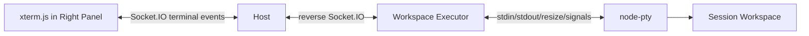
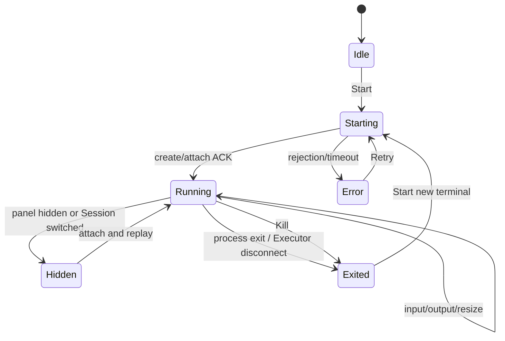

# Session Terminal Sidebar

**Status:** implementation design
**Scope:** Agent RunLab Dashboard, Host, Executor, and wire protocol
**Decision:** one persistent interactive terminal per Session, rendered in the shared right sidebar

## 1. Product goal

Agent RunLab shall provide a VS Code-like interactive shell for the selected Session. The terminal runs on the Session's Workspace Executor, starts in the Session `cwd`, and is displayed in a right-side panel shared with Inspector.

The terminal is a user-operated Workspace resource. It is not an Agent tool, its output is not appended to Session JSONL, and its input/output is never added to model context.

## 2. User experience

The right panel has two primary tabs: **Inspector** and **Terminal**. Desktop uses the existing resizable right panel. iPad uses the existing right-side drawer; phone uses the same drawer at full width.

The Terminal tab contains:

- status and resolved `cwd`;
- an xterm.js viewport;
- Start/Restart, Clear, and Kill controls;
- an always-visible responsive keybar (`Esc`, `Tab`, `Enter`, `Ctrl+C`, `Ctrl+D`, `Ctrl+Z`, `Ctrl+B`, and arrows), on desktop as well as touch devices;
- explicit states for Workspace offline, starting, running, reconnecting, exited, and error.

Opening the panel does not automatically start a shell. Hiding the panel or switching tabs does not kill it. Switching Sessions attaches to that Session's terminal; the previous Session terminal continues running. Explicit Kill, Session deletion, Executor disconnect/restart, or process exit ends it.

### Keyboard identity and ownership

Physical Enter, virtual-keyboard newline input, and the keybar's Enter send one carriage return (`CR`, `0x0d`, `\r`). Physical `Ctrl+J` sends line feed (`LF`, `0x0a`, `\n`); it is a different terminal input, not an alias for Enter. The Unix `script` PTY fallback must preserve these bytes, just like native `node-pty`. A shell's canonical line discipline can make both execute a command, so shell-only Enter tests cannot establish byte identity; use a raw-mode reader, including inside tmux.

While xterm is focused, physical control keys are handled by xterm rather than Dashboard shortcuts:

| Key | Input byte | Physical keyboard | Keybar |
| --- | --- | --- | --- |
| `Ctrl+C` | `0x03` | Yes | Yes |
| `Ctrl+D` | `0x04` | Yes | Yes |
| `Ctrl+Z` | `0x1a` | Yes | Yes |
| `Ctrl+B` | `0x02` | Yes | Yes |
| `Ctrl+J` | `0x0a` | Yes | No |
| `Ctrl+K` | `0x0b` | Yes | No |
| `Ctrl+U` | `0x15` | Yes | No |

These describe transmitted bytes, not guaranteed application actions: a shell may interpret `Ctrl+D` as EOF or `Ctrl+Z` as suspend, whereas a raw application receives the byte. tmux normally consumes `Ctrl+B` as its prefix; with default bindings, `Ctrl+B` twice sends one literal prefix to the pane. Browser/OS-reserved combinations still depend on the browser and platform.

Physical and keybar arrows follow xterm's current application cursor keys mode (DECCKM), as selected by terminal output. Normal mode sends CSI sequences (`ESC [ A/B/D/C` for up/down/left/right); application mode sends SS3 sequences (`ESC O A/B/D/C`). Keybar arrows must not hardcode normal-mode sequences when tmux or another application enables application mode.

Keybar interaction preserves xterm focus. Escape while the xterm textarea is focused is delivered to the terminal without dismissing its modal; Escape on terminal chrome and in ordinary dialogs retains normal dismissal behavior. The footer wraps on narrow screens rather than requiring horizontal scrolling, and workspace terminal dialogs follow the visible viewport's height and top offset so the keybar stays visible when the viewport shortens.

## 3. Architecture



### Responsibilities

- **Dashboard:** terminal rendering, keyboard/touch input, resizing, status, and user controls.
- **Host:** authenticate Session/workspace ownership, route messages, enforce ACK timeout, and isolate Session rooms.
- **Executor:** own PTY processes, enforce sandbox/capacity limits, buffer bounded output, and terminate resources.
- **Kernel/Session log:** no terminal output or terminal state.

## 4. Resource model

There is at most one live terminal for `(workspaceId, sessionId)` in the first version. `terminalId` identifies its current process generation.

Calling `terminal:create` is idempotent for a live Session terminal:

- if none exists, create one;
- if one exists, return its `terminalId`, resolved `cwd`, and bounded replay output;
- if the previous terminal exited, create a new generation only after an explicit Start/Restart action.

The Executor keeps a bounded ring buffer (target: 1 MiB) per terminal. Reattach returns a tail snapshot. This provides refresh and Session-switch recovery without persisting shell output.

## 5. Protocol

Dashboard to Host to Executor:

- `terminal:create` with `requestId`, `workspaceId`, `sessionId`, optional `cwd`, `cols`, and `rows`; ACK returns terminal identity, resolved cwd, optional replay, and whether it was reused.
- `terminal:input` with full resource identity and bounded data.
- `terminal:resize` with bounded rows and columns.
- `terminal:kill` with full identity; ACK confirms signal submission, while `server:terminal_exit` confirms exit.
- `terminal:close_session` is Host-to-Executor cleanup used on Session deletion.

Executor to Host to Dashboard:

- `executor:terminal_output` becomes `server:terminal_output` only in the authorized Session room.
- `executor:terminal_exit` becomes `server:terminal_exit` at most once per terminal generation.

Output is ephemeral and must not be queued across an Executor disconnect. A disconnected Executor closes every PTY; reconnect never pretends that the old process survived.

## 6. Security and limits

- Host validates dashboard handshake Session, payload Session, Session workspace, and connected Executor.
- Host validates Executor-originated terminal events against the workspace bound to that socket and current Session ownership.
- Executor independently rejects payloads for another workspace.
- `cwd` passes through the existing sandbox canonicalizer.
- A real `node-pty` is preferred; lack of PTY support is surfaced explicitly rather than represented as a fully capable terminal.
- Initial limits: 1 terminal per Session, 32 per Executor, dimensions `1..500`, input at most 64 KiB per event, replay buffer at most 1 MiB.
- Session deletion sends terminal cleanup before removing Session state.
- Terminal APIs do not accept shell command arguments from URL/query parameters.

## 7. Frontend design

`RightPanel` owns the Inspector/Terminal tab strip and collapse action. It renders:

- existing `InspectorPanel` without changing its internal Trace/LLM/Tools/Status tabs;
- `SessionTerminalPanel`, a reusable xterm.js component extracted from the existing Session Files terminal implementation.

The terminal component owns xterm.js and addons (`FitAddon`, `WebLinksAddon`, `SearchAddon`), subscribes before create/attach to avoid losing early output, uses `ResizeObserver`, and filters every event by workspace, Session, and terminal ID.

Desktop panel width retains the existing 22–36% limits. Mobile retains safe-area and dynamic viewport handling. The active primary tab is kept in Dashboard state; the existing Inspector-open preference remains the right-panel-open preference for compatibility.

## 8. Lifecycle



Unmounting the UI only detaches listeners; it does not send Kill. Kill is reserved for explicit user action and Session cleanup.

## 9. Failure behavior

- Workspace offline: disable Start and show reconnect guidance.
- ACK timeout: show timeout; do not assume process creation failed or succeeded. A subsequent idempotent create reconciles state.
- Executor restart: show exited/disconnected; require explicit Start.
- Browser reconnect: issue idempotent create/attach and apply replay before live output.
- Output overflow: retain only the newest bounded tail and indicate replay truncation when applicable.

## 10. Testing

### Executor

- sandboxed create, idempotent reuse, replay, dimensions, input, resize, kill, exit once, Session cleanup, limits, and workspace mismatch.

### Host

- dashboard Session/workspace authorization, Executor-origin validation, ACK timeout, room isolation, and Session deletion cleanup.

### Dashboard

- RightPanel tabs and collapse behavior; start, output, input, resize, clear, kill, Session switch, replay, offline/error states, and responsive keybar controls.
- Physical/virtual Enter, control-byte delivery, toolbar focus retention, normal/application-mode arrows, and terminal-versus-ordinary-dialog Escape ownership.

### Isolated Linux keyboard acceptance

`packages/dashboard/scripts/verify-terminal-keyboard.mjs` exercises real Chrome xterm → Socket.IO → Executor `TerminalManager` → PTY, with a raw Python reader both directly and inside an isolated tmux server. Run with an approved existing Chrome executable and existing dependencies:

```sh
KALA_TERMINAL_DISABLE_PTY=1 CHROME_PATH=/path/to/chrome node packages/dashboard/scripts/verify-terminal-keyboard.mjs
CHROME_PATH=/path/to/chrome TERMINAL_EVIDENCE_DIR="$PWD/.artifacts/terminal-keyboard/evidence-preferred" node packages/dashboard/scripts/verify-terminal-keyboard.mjs
```

The first run forces the Unix `script` fallback; the second allows native `node-pty`. JSON evidence records expected and observed raw bytes, including Enter versus `Ctrl+J`, and footer/button bounds. The fixture uses production workspace terminal dialog sizing and the production visualViewport hook.

Captured evidence in `.artifacts/terminal-keyboard/evidence/` and `evidence-preferred/` contains six screenshots each: desktop, expanded desktop, short desktop visual viewport, mobile, narrow mobile, and mobile with a shortened/offset visual viewport. All twelve were visually inspected: all eleven keybar buttons are visible, with no footer clipping; mobile uses two rows. Shortened visual viewports are simulated in Chrome, not genuine mobile software-keyboard acceptance. This local isolated Linux proof does not establish full Host deployment acceptance; separate Windows native-byte acceptance is recorded below.

### Genuine Windows native-byte acceptance

On 2026-10-24, the owner executed the standalone probe bundled from the current `TerminalManager` in a genuine disposable Windows 11 VM (`10.0.26300`, Node `22.22.1`, x64). All **11/11 byte assertions passed** through `TerminalManager` → real `node-pty`/ConPTY → raw-mode child, with no pipe fallback. The child reported stdin and stdout as TTYs and raw mode enabled. File-backed assertions distinguished Enter CR13 (`0x0d`) from `Ctrl+J` LF10 (`0x0a`) and verified Escape, `Ctrl+D`, `Ctrl+C`, `Ctrl+Z`, `Ctrl+B`, and the four normal-mode arrow sequences.

The owner-run evidence is in the session files at `windows-test/artifacts/windows-terminal-native-report.json` (alternate result: `results/hybridterminal20261024b.json`). An initially missing `probe-cases.cjs` was corrected by staging the complete probe directory; that was a staging issue, not a production fault.

This acceptance proves Windows native PTY byte delivery only. It does **not** establish Windows browser/xterm/Socket.IO keyboard behavior, toolbar or viewport behavior, application-cursor mode, tmux, or full Host deployment acceptance. The existing Linux browser/tmux/viewport evidence remains separately scoped above; the Windows non-PTY pipe fallback is not covered by the native ConPTY result.

### Release verification

- package typechecks and focused tests;
- production build;
- real Host/Executor smoke: `tty`, `pwd`, ANSI output, resize, `Ctrl+C`, hide/show, Session switch, and kill;
- mobile/iPad drawer overflow check;
- static JS assets return JavaScript MIME and stale assets return 404.

## 11. Rollout and rollback

The feature reuses the existing terminal protocol and xterm dependencies, reducing blast radius. Deploy after focused tests and build. Existing Inspector remains the default tab. If terminal UI fails, Inspector and the rest of Dashboard remain available; rollback is an immutable release generation switch. No Session data migration is required.

The keyboard fixes require upgrading both components:

- **Executor:** upgrade the Unix PTY fallback byte-preservation fix. Updating only Dashboard cannot stop an older Executor from rewriting Enter's CR into LF. Windows' non-PTY pipe fallback retains its existing CR-to-LF normalization; it is not evidence of full PTY control-key support.
- **Dashboard:** upgrade the responsive always-visible keybar, additional control buttons, focus preservation, application-mode arrow encoding, and visible-viewport workspace dialog positioning. Updating only Executor does not supply these UI fixes.

No Host protocol change or tmux/user-shell configuration change is required.
