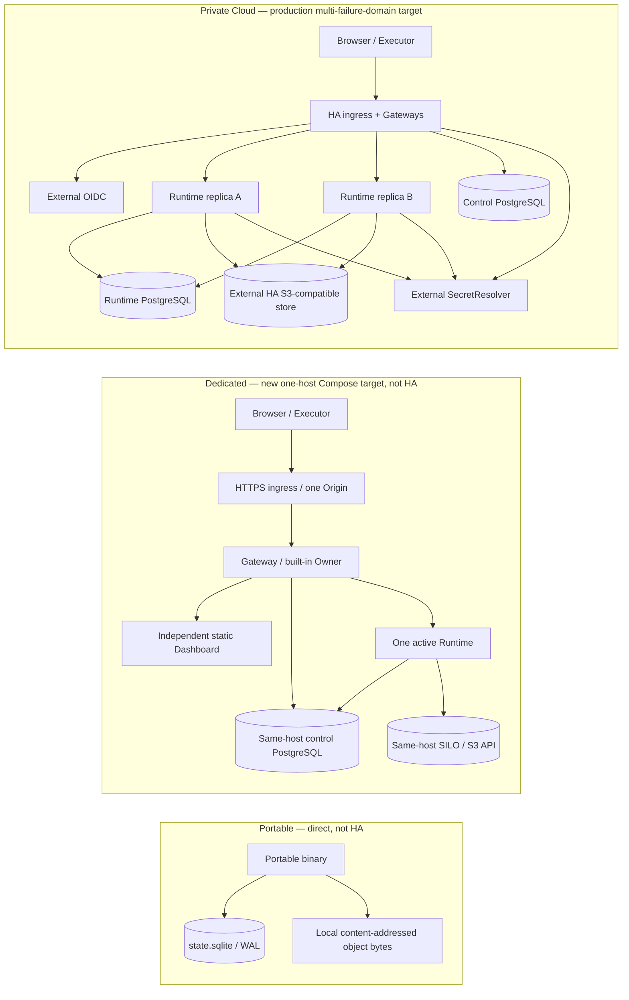

# Product Deployment Contract

**Status:** normative
**Scope:** product naming, deployment configuration, tenancy, capabilities, trust boundaries, and release acceptance
**Target revised:** 2026-10-23; implementation and release acceptance are tracked separately

## 1. Canonical product names

Agent RunLab has two runtime architectures and three user-facing variants. Every variant is operated by the user; the project does not define an officially managed service.

| Product | Architecture | Tenancy | Meaning |
|---|---|---|---|
| **Portable** | `portable` | effectively single-tenant | One distributable CJS or native binary, directly managed by the user |
| **Dedicated** | `platform` | `single-tenant` | The complete Platform dedicated to one tenant |
| **Private Cloud** | `platform` | `multi-tenant` | The complete Platform serving isolated tenants |

`Dedicated` and `Private Cloud` are configurations of the same Platform architecture. They are not defined by node count: either may evolve from one node to multiple nodes. `systemd`, containers, and Kubernetes are infrastructure choices, not product modes.

Removed product-mode names are not accepted as configuration aliases. New source, protocols, documentation, environment files, and operator commands use only the canonical schema and names.

## 2. Versioned configuration

The authoritative configuration is JSON so the CJS bundle, native packaging, systemd installer, containers, and tests share one strict parser.

Portable default:

```json
{
  "schemaVersion": 1,
  "architecture": "portable",
  "runtimeProfile": "full"
}
```

Dedicated:

```json
{
  "schemaVersion": 1,
  "architecture": "platform",
  "tenancy": "single-tenant",
  "runtimeProfile": "full"
}
```

Private Cloud:

```json
{
  "schemaVersion": 1,
  "architecture": "platform",
  "tenancy": "multi-tenant",
  "runtimeProfile": "agent"
}
```

`runtimeProfile` is a capability composition (`full` or `agent`), not a tenancy shortcut. Either Platform tenancy may select either profile. Unknown versions, fields, architectures, tenancy values, and profiles fail closed.

The Runtime reads `KALA_DEPLOYMENT_CONFIG`. Direct execution without this file is Portable. Platform deployments must provide the versioned file; no legacy mode environment variable is supported.

## 3. Topology is orthogonal

These are valid examples:

```text
Portable + one process
Dedicated + systemd + one host
Dedicated + Kubernetes + multiple nodes
Private Cloud + containers + one host
Private Cloud + Kubernetes + multiple nodes
```

The existing Dedicated systemd installer uses the second line, with blue/green Runtime and Deploy Supervisor. It remains an existing-installation implementation, not the target for **new** Dedicated installations. Do not modify its data or silently switch its storage backend. The new target is Aspire-defined, externally deployed Docker Compose on one host; Aspire/AppHost is a deployment definition and development orchestration surface, **not** a persistent production supervisor. The target drops Kala self-deployment, deploy-tool receipt handoff, blue/green slots and candidate routing. An operator outside the running Runtime (terminal/CI) publishes and deploys immutable artifacts.

### Target architecture for new installations (not an implementation claim)



In Private Cloud, multiple Runtime replicas can serve a logical Unit, but each mutable Session/Task/resource has one generation-fenced owner at a time. Local PG/S3 test containers validate storage semantics, **not** this availability or disaster-recovery target.

| Boundary | Portable | Dedicated (new target) | Private Cloud (production target) |
|---|---|---|---|
| Execution | Direct user-operated single program; no Docker, PostgreSQL or S3 prerequisite | Aspire AppHost specifies a Docker Compose deployment of separate ingress, Gateway/API, one active Runtime, Dashboard, PostgreSQL and S3-compatible containers on one host | Same Platform application semantics; separately operated edge/Gateway/Runtime with multiple failure domains and fenced placement; not dependent on Aspire |
| Human identity | Local Portable identity | Built-in single Owner login in Gateway, with credentials and revocable login state in control PostgreSQL; no external OIDC prerequisite | External OIDC and multi-tenant membership/policy in control PostgreSQL |
| Transactional authority | One `state.sqlite` (WAL) for Session events, Agent projection/checkpoint, Queue, DAG, scheduled tasks, receipts, object references and application metadata | PostgreSQL control and Runtime databases (may be separate databases/roles in one same-host PostgreSQL instance) | PostgreSQL control and Runtime authority, isolated least-privilege roles and production-grade availability |
| Object bytes | Local content-addressed object directory under the Portable data root; SQLite references protect acknowledged objects | Same-host S3-compatible container, initially PGSTY's MinIO-compatible SILO distribution subject to pinned-image and S3/recovery acceptance | S3-compatible external service with an independent failure, backup and recovery contract; local PG/S3 instances are valid **test infrastructure**, not proof of production HA |
| Secret values | Operator-protected local files/OS secret facility; never public application state | Protected operator-provisioned Compose secrets/files with least-privilege workload identities; Owner verifier and revocable login state live in control PG, database/object/provider credentials do not | External `SecretResolver` with workload identity, rotation and recoverability; local host files/Compose secrets are only test/evaluation adapters, not production secret HA |
| Persistence | No Session JSONL authority; JSONL may be explicitly exported | No Runtime/Gateway authoritative application-data volume; PostgreSQL/S3 containers have protected persistent data volumes | No Runtime/Gateway authoritative application-data volume; replace application nodes without losing acknowledged work |
| Upgrades | External binary replacement/restart | External operator/CI runs Aspire-generated Compose deployment and migrations with admission/drain/restart protocol; no Runtime self-upgrade | Coordinated multi-node operator process, versioned migrations, owner fencing and reconciliation; no HA claim before failure acceptance |

Secret lifecycle: credential references and operator-selected endpoints are configuration, not secret authority. External resolution authenticates with a workload identity and least-privilege policy; a projected JWT file is an identity bootstrap, not a local replica of provider secrets. Provider credentials are resolved for each new top-level LLM call with no positive value cache: rotation applies to the next call, and denied/unavailable resolution must not reuse an old value or dispatch a provider request. One admitted call (including its existing retry/stream lifecycle) pins its credential; rotation must not introduce replay of an already-started request. Resolver errors must not expose JWTs, secret values or external response bodies. TLS verification, bounded requests and no redirects are mandatory; explicit loopback HTTP is evaluation-only. Workload login tokens may be cached only in memory with a bounded lifetime (at most 60 seconds and no longer than the issued lease; the external role must also cap issued token leases at 60 seconds); a changed/unreadable projected JWT must prevent reuse of that token. Identity revocation must revoke outstanding secret-service tokens or wait out that documented bound; it is not equivalent to changing a local file.

Startup credentials (for example database pools, S3 clients and OIDC clients) remain pinned for the lifetime of those clients even when initially obtained through the external resolver. Their rotation requires coordinated drain/replacement and recovery with the correct durable encryption material; adding reference resolution does not establish hot rotation for all credentials. External-service HA, workload issuer integration, backup/restore, key recovery and cross-failure-domain operation require separate deployment evidence. Local adapters remain explicit Portable/Dedicated/evaluation choices, never an automatic fallback after an external resolution failure.

Dedicated ingress is a deployment responsibility, not a mandatory application component or certificate issuer. A self-contained `bundled-caddy` profile may provide reverse proxy and automatic TLS; an `external` profile uses an operator-owned existing proxy/load balancer and TLS custody without any Caddy resource, image, hostname parameter or certificate volume. Both preserve one HTTPS public Origin for authentication, cookies and Origin validation. Only the Gateway HTTP handoff may additionally bind IPv4 loopback in external mode, never a wildcard plaintext public endpoint; a same-network proxy may also use its private Compose address. Application mode/connection configuration is operator input, not automatic OAuth App registration or embedded certificate/key material. A built-in Dedicated mode descriptor is a safe template, not customer identity or deployment authority; operator-supplied descriptors must retain the Dedicated storage/tenancy contract.

Dedicated initialization is an external operator ceremony, not a Runtime self-deployer. Before any mutation, authority bind sources must be existing dedicated directories with disjoint canonical paths, not missing paths, root aliases, symlinks or nested PG/object roots. Container creation is not readiness: successful application startup requires bounded readiness for the selected reviewed deployment graph (five core services with external ingress, or six with bundled Caddy, plus explicitly enabled management telemetry resources), while claim/schema/Owner initialization remains a prior gate. Fresh Owner bootstrap stays transactional and non-idempotent. Explicit continuation of an already-initialized installation must skip provisioning/migrations/bootstrap, prove the original protected Owner password and expected active Owner/Organization state, and rely on the same installation/checkpoint/state-key startup barriers; it must not reset credentials or silently accept an arbitrary existing Owner. A failed/timed-out start must not print success or automatically delete data, reset markers or roll back unknown work. These startup guarantees are not full Agent/public-TLS acceptance or an upgrade/backup/restore product.

Dedicated management observability is separate from the product UI and deployment authority. Bundled Caddy additionally exposes only aggregate HTTP server metrics on an unpublished private metrics listener, collected through a bounded, label-allowlisted pipeline; external-ingress publications must not fabricate or scrape a nonexistent Caddy. Online PG and artifact S3 client calls emit bounded CLIENT spans with fixed operation names and no SQL/parameters/table/bucket/key/URL/raw errors. Short HTTP parent contexts expire on response completion and must never become persistent WebSocket contexts. The optional reviewed telemetry profile adds a standalone Aspire Dashboard, an authenticated OTLP Collector and a finite runtime-readiness job. Apart from the explicit external-ingress Gateway loopback handoff, only the management UI may bind an additional host port, explicitly on IPv4 loopback; OTLP ingestion stays private and authenticated. Browser, ingestion and Dashboard export/API credentials must be distinct. The standalone Dashboard is a bounded ephemeral diagnostics viewer, not a Compose supervisor, a durable audit authority or a substitute for an external history/alerting backend. Application exports must use explicit safe metadata, bounded queues/timeouts/retries and no disk spool; export failures must not block business. Default exports exclude prompts, thinking, source, paths/query strings, bodies, credentials and unrestricted identity labels. Long-lived socket connections are not individual business spans. Agent/model/tool/approval/retry/recovery spans must come from authoritative timing observations with opaque correlation identifiers; interruption must preserve unknown execution semantics, not fabricate success or replay work. HTTP admission traces, server-observed Agent/tool timelines and native SDK/Executor traces are distinct boundaries: none alone proves an end-to-end command trace. Infrastructure health and operator diagnostics are distinct from continuous metrics/alerting. The Dedicated telemetry profile must also collect real bounded PostgreSQL cluster/database statistics through an independent monitoring-only identity and authenticated SILO server/S3 metrics through a metrics-only credential, without exporting SQL samples/plans, object/bucket/user labels or business credentials. Database aggregate collection must not require application-table DML access. Collector must not receive the Docker socket or provider root credentials. Product UI availability is a separate active HTTP observation. These observed services must appear under their real service identities; this is not an invented AppHost resource lifecycle feed. Standalone Dashboard remains a telemetry viewer, not a complete Docker topology/status controller. Dedicated monitoring credential preparation is an explicit root-operator step before publication; retries preserve existing monitoring credentials, and lifecycle provenance includes them.

Dedicated cold lifecycle operations are external root-operator actions with a shared host lock, not Runtime self-deployment. A completed cold backup must stop public admission first, stop all application writers and enabled telemetry resources, then prove clean PG/object-server shutdown before archiving the complete PG and SILO roots (including versions/IAM), the actual protected mounted installation/key/configuration material, and, only for bundled Caddy, its data/configuration roots (including private keys, internal CA and ACME state). External admission must be independently fenced with an explicit operator acknowledgment before initialization or lifecycle mutation; stopping local containers is not external load-balancer fencing. External issuer/keys/certificates remain separately managed and are not represented as application-backup contents. The recovery root must contain the reviewed Compose, parameter file and all non-data bind sources; copying a lookalike key or omitting mounted configuration is not an accepted backup. An archive/manifest completion marker checks integrity, not authenticity against a hostile operator. Artifacts contain secrets and require private protected storage and off-host custody appropriate to the deployment. Unknown external Executor/provider effects are not settled by stopping containers and must never be automatically replayed.

Dedicated cold restore requires explicit source fencing acknowledgment, verified complete inventory/checksums/image provenance/PG-major compatibility and fresh empty disjoint destinations. Original UID/GID/mode and complete object-store state must be preserved. Never overwrite an existing authority root or automatically start both copies. Bundled trust-preserving recovery includes ingress certificate/private-key/CA/ACME state and must preserve existing client trust, not silently reissue it. External-mode application recovery restores only PG/SILO/protected configuration and explicitly reports that external TLS identity was not restored; its independent custodian must retain or recover client trust. Never infer that external TLS was preserved from an application-backup success. Cross-mode cutover requires a separate maintenance/trust ceremony, not implicit restore or in-place upgrade. Restoring a legacy incomplete artifact requires an explicitly acknowledged ingress-identity reset and trusted redistribution; it must not be reported as trust-preserving recovery or use TLS-verification bypass. Stored ACME material alone does not establish public DNS/renewal acceptance. Upgrade requires an exact reviewed predecessor/target policy and a completed pre-upgrade backup. The initial operator supports same-schema, same-PG-major transitions only and refuses migration policies; neither an arbitrary policy nor a same-image smoke constitutes verified release compatibility. Failed startup leaves state for inspection; rollback means a separately authorized coordinated restore, not blind old-image replay over mutated data.

Dedicated Owner credential changes preserve the canonical existing principal/Organization and require an active Owner/membership/contract. Normal changes verify the existing password; explicit lost-password recovery requires the local root operator and protected confirmation files, never a service token or automatic bootstrap. Password replacement and revocation of existing browser sessions must be one transaction, with no verifier-strength downgrade. Generic database/S3/service-secret hot rotation and arbitrary state-master-key replacement remain unsupported until provider-specific overlap/revocation or decrypt/re-encrypt protocols are implemented and verified; fail-closed refusal is mandatory rather than a misleading successful file replacement.

SDK-native continuation state belongs to the same transactional authority as the Session, not to a replaceable node's local CLI directory. For new durable installations, Copilot uses the supported SDK `SessionFs` callbacks to persist its original event journal/checkpoints under the Session authority (SQLite in Portable; the same owner-fenced PostgreSQL Session authority in Platform). Raw native journal content is internal restoration data, not another user-visible message stream or permission to re-execute old tools. An existing conversation whose native checkpoint cannot be resumed must fail closed with a durable error; it must not silently become an empty model session. A crash after tool dispatch but before a durable result must preserve an explicit `execution_unknown` outcome and call identity: a transport error is neither proof of tool failure nor proof of rollback. Recovery must not fabricate a successful receipt or automatically replay the effect; reconciling the external target and authorizing a retry are distinct operations. Provider credentials, SDK executables, external Workspace files and configuration still have separate recovery boundaries. A stopped-writer SQLite/CAS copy is only a subset recovery set unless any encrypted state's master key and required external dependencies are independently available.

Native files are stored in dedicated `usage` / `nodes` / immutable `chunks` tables in that same SQLite or PostgreSQL authority, **not** as a file-tree snapshot inside the Session projection or audit payload. Append reads file/usage metadata and inserts only new chunks; it does not read or rewrite old file contents. Each operation proves the parent Session is live; Platform operations also prove the current tenant/resource-owner generation inside the transaction. Tombstones reject file operations and final Session deletion removes native rows in the same transaction. Per-chunk hashes and sequence/size checks fail closed on damaged or incomplete reads. The initial supported logical budgets are 256 MiB per Session, 128 MiB per file, 10,000 nodes and 4,096 UTF-8 bytes per path; these are bounded implementation limits, not unlimited context, a physical database quota or a throughput/HA claim. SDK `readFile` still materializes a whole requested file. New Platform operator migration 7 and DML-only Runtime grants include these tables; Gateway routing readers cannot read raw native file bytes. The earlier experimental nonempty V1 document snapshot is rejected and is **not automatically migrated**, and legacy unmarked installations retain their existing storage path.

The Executor must durably record a call's scoped identity **before** entering an ordinary agent-tool runner, then commit its completion receipt before acknowledging a confirmed result. A surviving process coalesces duplicate in-flight requests; a restarted process with an unresolved started record returns explicit `execution_unknown` and must not re-enter the runner. Unresolved records are not completed-result cache entries: neither TTL nor capacity eviction may remove their replay barrier. The initial local receipt store admits at most 500 unresolved records and fails new agent-tool admission closed at that limit; an unreadable or malformed existing journal also fails admission closed, rather than becoming an empty cache. Failed pre-run admission releases its in-memory slot because no runner entered; post-run durability failure must retain uncertainty. Read-only internal Workspace discovery RPCs remain independent of agent-effect receipt availability. This receipt journal lives at the Executor's external Workspace execution boundary, not in replaceable Runtime/Gateway scratch, and must be preserved with that Executor installation. An Executor binary that predates started-record handling is not a safe rollback target while unresolved records exist: release/rollback must retain a started-aware reader, not silently downgrade the replay barrier. Loss of the journal/Workspace, cross-machine replacement and operator-authorized reconciliation are separate recovery gates; this mechanism does not make arbitrary external systems exactly-once or introduce automatic retry after an unknown result.

Scheduled occurrences recover throughout a serving scheduler's lifetime, not only at process startup: a replica that gains the relevant fenced owner after startup must reconcile retained `claimed` occurrences on subsequent serialized polls before admitting fresh due work. Recovery uses the immutable claimed snapshot and original occurrence/operation identities. A confirmed durable admission receipt settles the occurrence as enqueued without requiring the original Workspace to be online again; only proven-absent admission may enter fresh target validation and delivery with the same operation ID. Unknown or unreadable receipts require explicit review without replay. Losing ownership cannot be overridden by a scheduler lease or a timer, and stopping a scheduler must stop new admission while preserving unresolved claims for a later owner. This is occurrence/admission recovery, not a promise to automatically restart external work or replay an arbitrary tool.

These are **design requirements**, not an assertion that the current artifacts already satisfy them. A Session is not recovered merely because its messages are stored: SDK continuation, pending tool calls, receipts, cancellation, owner fencing and unknown external side effects each require restart/failover tests. Application-node scratch is bounded and disposable. PostgreSQL and object-store volumes are intentionally durable and require explicit provisioning, backup and deletion safeguards; `down --volumes` is not an application upgrade procedure. Same-host Dedicated remains one failure domain, not HA. The target SILO image replaces historical `pgsty/minio` according to [PGSTY's migration documentation](https://silo.pgsty.com/compatibility/migration/); pin its image/tag/digest after compatibility tests rather than infer them from a moving tag.

**Current delivery boundary:** Existing installations remain on their original code/storage path. Fresh explicitly marked Portable installations have SQLite-backed Session/Agent/Queue/scheduler state and local CAS references. Isolated packaged Portable tests have exercised real Copilot/Executor work, conservative in-flight unknown-effect recovery, and model-context recovery without the original SDK cache; the row/chunk provider has separately passed real SQLite and PG cross-scratch SDK recovery with a 20 MiB auxiliary capacity file. A new Dedicated Aspire-published six-service topology has now passed CA-verified Owner HTTPS login, organization-invited real Executor/Copilot tool execution, S3 object hash/access checks, and an **isolated stopped-writer coordinated recovery subset**: control PG + Runtime PG + full SILO data restored into independent roots, replacement workload credentials with old PG/S3 credentials rejected, wrong-state-key startup refused, real native model-memory recovery and a new tool call through the original external Executor identity. No application-node SDK cache or authoritative data volume was restored. The isolated new Private Cloud profile has also exercised strict external-OIDC/two-Organization login, same-ID tenant data/object isolation, real Executor tools, stale-cache owner-loss recovery, conservative busy-effect recovery, and live-process PG-only partition takeover followed by fresh-membership automatic re-entry without reclaiming the survivor's Session. A separate new empty Unit exercised remote suspend/delete precedence over recovery. A later shared-PG identity slice used two independent Gateways with the same real opaque OIDC session: a formal revoke through the second Gateway blocked an independently enrolled device's existing execution bindings on both Runtimes, while its enrollment route remained valid and the original device remained usable. This is not full cross-Gateway browser/member/service-account revocation or credential-lifecycle acceptance. Membership readiness is not immediate Workspace availability; long-lived Executor rediscovery has its own bounded interval. These bounded source-only subsets do not close full enterprise identity, all tenant/channel boundaries, generic multi-owner failover or production HA acceptance. Generic unknown-effect resolution, production backup/secret-service automation, release-grade upgrades and performance/soak gates are still pending; the cold recovery test is not automatic failover, a general disaster-recovery guarantee or release certification. No existing installation is automatically migrated. Consult the [temporary migration plan](./three-mode-aspire-migration-plan.tmp.md) and the [Private Cloud evidence ledger](./private-cloud-design-status.md) for exact tested revisions and remaining gates.

Background schedules delegate a durable principal, not a browser login or a captured `member` role. Platform must recheck the original human membership/role or service-account scope/expiry/revocation, Organization/contract and exact Unit in shared control authority both before scheduled admission and before dispatching its queued work. Logout alone does not revoke a separately authorized schedule. Runtime uses a bounded authenticated control-service request; it must not read control tables with its Runtime PG identity, cache positive decisions indefinitely or fall back to a manufactured role. Persist server-owned principal attribution with the queue item; malformed attribution and older unattributed scheduled items fail closed. Confirmed admission receipts may still settle without starting work. Explicit denial blocks new work; control-service unavailability preserves pending identity and permits a later pre-dispatch retry, never an unknown-effect replay. Already-started external work retains the existing receipt/unknown semantics. Only the original principal may edit or resume a schedule; Organization Owner/Admin may pause or delete another principal's schedule but must create their own delegation rather than rewrite or reactivate it. An admitted scheduled queue item is immutable, including through ordinary queue-edit APIs. This is Organization/principal reauthorization, not the still-unimplemented end-to-end Workspace-grant capability. Delegated persisted queue items use an explicit versioned encoding which old PG/SQLite readers reject; legacy metadata snapshots use a new envelope version rather than letting an old reader silently omit an item. Upgrade/drain all older scheduling replicas before enabling this policy, and do not roll back while delegated work remains pending.

## 4. Capability contract

`GET /runtime/capabilities` returns authoritative product configuration and capabilities:

```json
{
  "product": "dedicated",
  "deployment": {
    "schemaVersion": 1,
    "architecture": "platform",
    "tenancy": "single-tenant",
    "runtimeProfile": "full"
  },
  "capabilities": {
    "agent": true,
    "workspace": true,
    "operations": true,
    "artifacts": true,
    "pipeline": true
  }
}
```

The Dashboard remains fail-closed until it validates the whole payload. A failed or malformed request must not infer Dedicated or expose disabled capabilities. Server checks remain authoritative.

The current `agent` profile keeps Agent, Workspace, Executor, File, Git, Shell, and Artifacts while disabling Operations/Pipeline entry points. Disabled capabilities must be absent from navigation and denied by raw HTTP and Socket.IO protocols.

## 5. Identity and routing

Portable may use local/shared-token authentication. **New Dedicated must use a built-in single-Owner Gateway login** backed by its control PostgreSQL, rather than sharing a bearer token with every browser; machine/Executor authentication remains a distinct credential. Its ordinary browser password form must preserve a non-null same-origin `Origin` on navigation POST: use a same-origin referrer policy rather than `no-referrer`, which makes Chromium send `Origin: null` for this form. Cross-origin referrer disclosure stays disabled, and null/cross-origin login POSTs remain rejected; do not fix a broken first login by weakening Gateway origin validation. API requests with a manually supplied valid Origin do not establish real-browser login acceptance. Existing Dedicated installations retain their historical authentication until an explicit, separately accepted migration. Private Cloud uses its Gateway/control plane to resolve the *current* Organization membership, permissions and placement to one logical `TenantRuntimeUnit`; identity is not permanently assigned to its own Unit.

For each authenticated browser Runtime request, Engine.IO poll or WebSocket upgrade, the Gateway:

1. verifies the revocable product session and current Organization permission;
2. resolves the Organization's Unit and current server-side placement;
3. removes browser-supplied routing authority;
4. writes trusted routing and service credentials;
5. pins an established connection to its chosen owner until closure or reconnect, then re-resolves placement.

The Dashboard's global control channel, not just its routed Session channels, must initiate a direct WebSocket connection. A Unit-routed Gateway that cannot prove upstream Pod stickiness for Engine.IO's server-generated polling `sid` must reject polling rather than route subsequent polls independently. The Dashboard must not depend on a successful polling handshake before attempting WebSocket; otherwise normal first load is blocked even with valid authentication and healthy Runtime replicas. This does not require enabling polling on routed Gateways or changing legacy/Portable server transport support. A Session-bound Workspace RPC client waits for its existing `session:<id>` subscription; it must not add a broad `workspace:<id>` channel to a socket whose route capability is restricted to one Session. Multiplexed control sockets continue to acquire Workspace channels for authorized directory/control reads, but they are not an execution capability. New Dedicated uses an independent Session-scoped WebSocket for active-Session operations, including Workspace effects, even though its single-Runtime Gateway does not issue Private Cloud route tickets. The existing direct Session authentication and Owner cookie suffice; do not enable broad control-socket effects or introduce fake route tickets. Portable/legacy shared-control behavior is unchanged, and unselected views retain their control channel. A first Workspace or directory RPC waits for the relevant accepted subscription acknowledgement; transport `connect` alone is not Session readiness while the Host hydrates its asynchronous namespace. Current-Session preference/view-state mutations also use the owner-routed Session transport, not the Unit control socket. Interactive terminal input preserves the received byte/chunk order per Workspace/Session/terminal before the first asynchronous access or owner check; authorization completion order must never become shell input order. Distinct terminals can progress independently, each queued input is still freshly authorized, and settled queue tails are released. This is input-stream integrity, not durable or exactly-once terminal delivery across process loss.

Session-scoped browser HTTP must use the same authoritative live Session owner as its WebSocket channel, not the Unit's least-loaded control origin. This includes message admission, attachment upload/release/download, Session artifact registration/preview and tool-result/tool-lock queries. Derive the Session ID only from each matched API's defined JSON, query or path field and bind owner lookup to the current authenticated Organization and Unit; never accept a client-selected origin or routing authority. Resolve before forwarding any payload, preserve buffered JSON bytes, stream query-addressed file uploads, and do not retry another Runtime or fall back to the Unit control origin on missing/deleting/relocating/unavailable ownership. Unit-level APIs and private handoffs remain distinct.

Session mutations initiated outside the active transcript (including sidebar delete/rename and metadata preferences) obey the same target-Session owner boundary. A Unit control socket or the currently selected Session's capability is not authority for another Session. Obtain a fresh target-bound route ticket in Private Cloud, wait for that target's Session readiness, send the command only on its authorized connection, and retain the connection until the existing operation receipt/ACK resolves. Do not retry a command on another owner or fall back to control after an unknown result. Routing absence, authorization failure and relocation are visible failures, not permission to mutate a cached projection. Portable keeps shared-control behavior; Dedicated may use its existing direct Session-scoped cookie authentication without inventing route tickets. The Host binds such single-Session ingress payloads from its server-selected deployment mode and trusted ingress actor, not a client-provided widening flag; unmarked legacy/Portable shared preview behavior remains unchanged. Each preference/model mutation reasserts the live Session owner before entering Runtime or storage writes, rather than treating connection-time placement as a permanent lease.

Routed Executors continuously discover authorized live replicas rather than fixing exclusive/fleet topology once at process start. A newly observed parallel topology must finish the existing token enrollment, drain the exclusive route's active tools/terminals, then attach replica sockets using the same device identity and shared execution receipts. Once parallel membership has been observed, an unavailable discovery response must not silently restore an unscoped exclusive route. Closing one replica socket may request cancellation but must not release its shared in-flight call barrier until the original handler has settled and installed its result/explicit durability-failure replay barrier; a receipt failure is not permission to retry. Cancellation is not proof that external effects stopped. Other sockets must coalesce the same `(sessionId, callId)`, not spawn it again.

An Executor route hint proves only where to route, not that its current device credential is still valid. Gateway checks of enrollment-route/Organization authority do not replace Runtime checks of the shared Unit-scoped device identity authority. Credential revocation or rotation must invalidate established device bindings on every serving replica: revalidate periodically to close idle channels, and revalidate before dispatching tools, Workspace/MCP operations or terminal control. Validation errors/timeouts fail closed; a transient authority outage must not be reported as permanent credential revocation. Withdraw invalid bindings without reconnect-grace replay of their pending effects; already-started external work remains unknown unless a durable result proves otherwise. A new credential needs a fresh authenticated binding. No new broker or application-node identity cache is an authorization authority.

Machine Executor credentials and anonymous public paths have distinct authentication rules; neither is a browser session. The Runtime Host knows Unit tenancy and a trusted opaque Organization ID only as a storage namespace, plus deployment-boundary credentials; it does not receive user profiles, passwords, OIDC tokens, memberships, billing identity or RBAC policy.

## 6. Unit isolation

Each logical `TenantRuntimeUnit` owns separate Session stores, queues, Workspace/Executor identities, operation receipts, artifacts and notifications. Its serving Runtime replicas keep Unit-scoped Socket.IO instances, namespaces, recovery buffers, caches and timers; persistence authority need not be a directory or one process. Tests deliberately reuse identifiers across Units and prove no leakage.

Delegation creates a distinct child Session in the same Unit authority and inherits the parent's authorized Workspace and working directory, not a new identity or wider grant. Effective child tools are the intersection of parent-available tools, the selected role and any explicit allowlist. The resulting tool-name ceiling is retained in the child's durable creation manifest: cached inspection, reload and cold restore may select current Runtime implementations only within that ceiling, including an explicitly empty set; they must not replace it with the Runtime's full tool catalog or implicitly admit newly added tools. Headless child auto-approval avoids waiting for a nonexistent human subscriber; it never bypasses Unit/Workspace/device/owner authorization or a role's denied tools. Explicit positive turn and time budgets are ceilings, not hints to be silently raised to role defaults or minimums. Role defaults apply only when omitted. Child transcript inspection is independently authorized and owner-routed: a parent-bound Session socket/ticket must not subscribe to a child's room. Parent lifecycle/list/interrupt coordination stays parent-scoped; Portable shared-control subscriptions remain supported. A completed child result alone does not prove Workspace tool execution or inspectable child history.

Where a runtime supports Fork, conversation ancestry is not delegation depth. Forking an ordinary top-level Session retains delegation depth zero and must not disable its first `agent` call. An `agent`-created child adds one delegation level; forking a delegated Session inherits, rather than resets or increments, that depth and its durable tool-name ceiling. Repeated forks must not regain denied tools or bypass the delegation cap. Persist this distinction in the current Session authority so cached and cold loads agree without depending on loaded ancestors. Legacy lineage lacking sufficient provenance remains conservatively scoped under its existing restrictions; an ambiguous historical parent link alone must not be silently reclassified to unlock tools. This compatibility rule does not change old installations' storage authority or imply Fork support for a runtime that declares it unsupported.

Platform container images provide one root-owned, non-writable, matched Copilot executable/native-library pair in the immutable image layer, selected through `COPILOT_CLI_PATH`. They must not materialize executable code into each Unit's mutable scratch. Unit-scoped SDK `baseDirectory`, authentication/configuration context and disposable caches remain isolated; sharing executable bytes does **not** share Session state or identity. The existing read-only root and `noexec,nosuid` tenant-scratch mounts remain in force. Portable retains its packaged-runtime materialization fallback; its storage authority and installation layout are unchanged.

The SDK `baseDirectory` is private, per-Unit disposable scratch and must be created with owner-only permissions even when there is no local Session directory and executable materialization is bypassed. Shared immutable code must not accidentally become responsible for creating mutable Unit state.

A Session projection cache is valid for mutation only within its current live resource-owner activation. Read-only inspection may load a projection without acquiring ownership; such a record is not a writable cache entry. Before dispatch, acquire/assert the live owner and reload the authority projection if the cached activation differs or is absent. SQL transaction fences remain authoritative; a cache epoch is not an authorization credential. A Session dispatch/projection failure must not terminate the shared Runtime process or silently replay accepted model/tool I/O. Preserve durable queue/claim/receipt evidence, suspend that Session's local drain until a successful explicit Stop, and do not release a failed running-effect claim as if it completed; missing shell receipts still become `execution_unknown` on claim expiry.

A lost placement, replica membership or Session-owner activation withdraws that local Unit immediately and closes its sockets, timers, stores and callbacks. A live Runtime process must reconcile the authoritative Unit catalog after transient failures; node process health alone is not Unit availability. Re-entry requires completed teardown, a fresh catalog read showing `ready` with the same Organization binding, and newly validated placement/membership. It constructs a new local Unit, never revives the fenced object or silently reacquires its former Session owners. Reconciliation is bounded, single-flight and stopped before Host drain; it does not increment the operator's lifecycle generation or synthesize a resume/provision command. Authoritative suspend/delete and a changed generation observed during activation win over recovery, and unknown external effects are never replayed merely to restore availability.

Logical Unit isolation is not claimed as container/VM isolation. Multi-node placement requires explicit leases and per-resource fencing; copied files do not grant writer ownership.

## 7. Release lanes

Platform releases have separate Runtime/control-plane and Dashboard artifacts. Stable
Ingress serves or proxies the active Dashboard generation independently from active Runtime
Units. A Dashboard-only activation changes no Runtime PID/container, Unit route generation,
write lease, Session continuation marker, or Executor connection. Dedicated uses a
versioned request/receipt protocol and atomic static-release route state; Private Cloud uses
an independently replaceable Dashboard image. Portable alone embeds Dashboard assets in
the CJS/native executable and upgrades them together. Long-lived browser tabs periodically
check the Dashboard Service Worker, automatically activate a newly waiting generation, and
perform one controlled reload; unsent Composer drafts survive that reload. A tab does not
remain indefinitely on mixed assets merely because Socket.IO still reports connected.

### Portable

- execute the released CJS and each supported native binary directly;
- create and recover Sessions and Workspaces;
- exercise Browser, Executor, File/Git/Shell, Artifacts, Operations, and Pipeline according to the configured runtime profile;
- verify graceful shutdown and documented replace-and-restart upgrade semantics.

### Dedicated (new target acceptance)

- provision fresh protected PostgreSQL and S3-compatible volumes and deploy the Aspire-defined Compose topology from outside Kala; assert only the ingress is published and an unconfigured Owner cannot log in;
- prove Owner bootstrap, revocable login, one-origin HTTP/WebSocket routing, one active Runtime, exact image digests, schema migration, admission/drain and external rollback protocol;
- verify real Copilot CLI authenticated Session/Agent continuation, Executor tool receipts, full capability flows, Dashboard independent replacement, persistence after Runtime/Gateway recreation and PostgreSQL/S3 backup/restore; show failures explicitly rather than promising zero downtime or automatic rollback;
- test that old systemd installations and their data remain untouched. The old systemd blue/green/Supervisor acceptance applies only to the old installer, not the Aspire target.

### Private Cloud

- deploy the complete user-operated container stack behind one product Origin; Kubernetes is an optional orchestrator, not a prerequisite for the Private Cloud product mode;
- create at least two temporary identities and isolated Units;
- reuse identifiers across Units and prove Session, Workspace, Executor, File, Shell, Artifact, and notification isolation;
- prove authentication lifecycle, Gateway bypass denial, HTTP/WebSocket stickiness, coordinated PostgreSQL/S3 backup/restore, upgrade, and cleanup. Local PG/S3 test instances are allowed, but production HA additionally requires distinct failure domains, fenced multi-node takeover and actual failover/recovery evidence.

A rendered page or HTTP 200 alone is never task-chain acceptance.

## 8. Derived documents

- Dedicated systemd architecture (existing installations): [`dedicated-platform-runtime-unit.md`](dedicated-platform-runtime-unit.md)
- New-installation target and phased acceptance: [`three-mode-aspire-migration-plan.tmp.md`](three-mode-aspire-migration-plan.tmp.md)
- Private Cloud Runtime Units: [`private-cloud-runtime-units.md`](private-cloud-runtime-units.md)
- Dedicated operator lifecycle: [`../operations/dedicated-operator-cli.md`](../operations/dedicated-operator-cli.md)
- Dedicated cutover runbook: [`../operations/dedicated-platform-runtime-unit-cutover.md`](../operations/dedicated-platform-runtime-unit-cutover.md)
- Historical legacy migration handoff: [`../operations/dedicated-platform-systemd-external-agent-handoff.md`](../archive/programs/dedicated-platform-systemd-external-agent-handoff.md)
- Private Cloud local operations: [`../operations/private-cloud-local-runbook.md`](../operations/private-cloud-local-runbook.md)
- Authenticated browser shell: [`../design/authenticated-product-shell.md`](identity-and-security/authenticated-product-shell.md)
- Verification policy: [`../meta/testing.md`](../standards/release-quality/testing.md)

**Target SoT precedence:** this contract alone decides all three modes' target identity, topology, scaling, storage, secrets, release lifecycle, backup/restore and preservation of existing installations. The [Private Cloud enterprise contract](./private-cloud-enterprise-architecture-contract.md) may refine Private Cloud invariants but cannot override this contract. The [Private Cloud design/status ledger](./private-cloud-design-status.md) records implementation/evidence, not target authority. Implementation records, release artifacts and operator runbooks apply only to their explicitly named implementation/version. If any lower-level document conflicts with the target here, this contract wins and the discrepancy is recorded as a gap or legacy behavior, not silently harmonized by changing the target.
