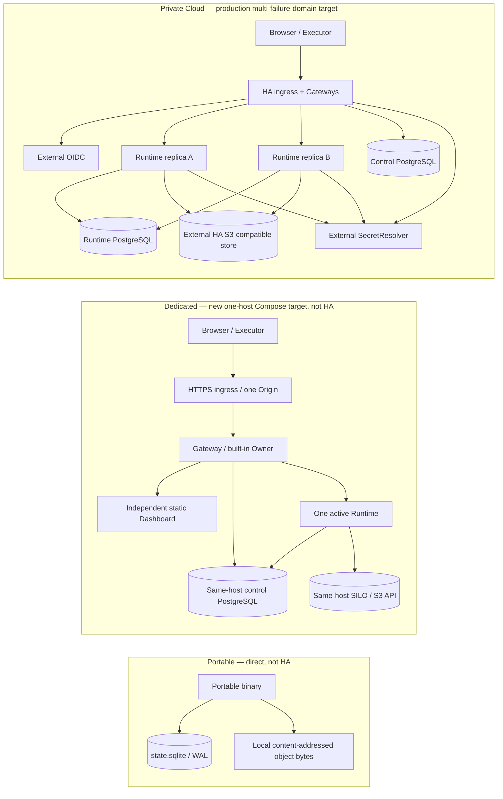

# Product Deployment Contract

**Status:** normative
**Scope:** product naming, deployment configuration, tenancy, capabilities, trust boundaries, and release acceptance
**Target revised:** 2026-10-23; implementation and release acceptance are tracked separately

## 1. Canonical product names

Agent RunLab has two runtime architectures and three user-facing variants. Every variant is operated by the user; the project does not define an officially managed service.

| Product | Architecture | Tenancy | Meaning |
|---|---|---|---|
| **Portable** | `portable` | effectively single-tenant | One distributable CJS or native binary, directly managed by the user |
| **Dedicated** | `platform` | `single-tenant` | The complete Platform dedicated to one tenant |
| **Private Cloud** | `platform` | `multi-tenant` | The complete Platform serving isolated tenants |

`Dedicated` and `Private Cloud` are configurations of the same Platform architecture. They are not defined by node count: either may evolve from one node to multiple nodes. `systemd`, containers, and Kubernetes are infrastructure choices, not product modes.

Removed product-mode names are not accepted as configuration aliases. New source, protocols, documentation, environment files, and operator commands use only the canonical schema and names.

## 2. Versioned configuration

The authoritative configuration is JSON so the CJS bundle, native packaging, systemd installer, containers, and tests share one strict parser.

Portable default:

```json
{
  "schemaVersion": 1,
  "architecture": "portable",
  "runtimeProfile": "full"
}
```

Dedicated:

```json
{
  "schemaVersion": 1,
  "architecture": "platform",
  "tenancy": "single-tenant",
  "runtimeProfile": "full"
}
```

Private Cloud:

```json
{
  "schemaVersion": 1,
  "architecture": "platform",
  "tenancy": "multi-tenant",
  "runtimeProfile": "agent"
}
```

`runtimeProfile` is a capability composition (`full` or `agent`), not a tenancy shortcut. Either Platform tenancy may select either profile. Unknown versions, fields, architectures, tenancy values, and profiles fail closed.

The Runtime reads `KALA_DEPLOYMENT_CONFIG`. Direct execution without this file is Portable. Platform deployments must provide the versioned file; no legacy mode environment variable is supported.

## 3. Topology is orthogonal

These are valid examples:

```text
Portable + one process
Dedicated + systemd + one host
Dedicated + Kubernetes + multiple nodes
Private Cloud + containers + one host
Private Cloud + Kubernetes + multiple nodes
```

The existing Dedicated systemd installer uses the second line, with blue/green Runtime and Deploy Supervisor. It remains an existing-installation implementation, not the target for **new** Dedicated installations. Do not modify its data or silently switch its storage backend. The new target is Aspire-defined, externally deployed Docker Compose on one host; Aspire/AppHost is a deployment definition and development orchestration surface, **not** a persistent production supervisor. The target drops Kala self-deployment, deploy-tool receipt handoff, blue/green slots and candidate routing. An operator outside the running Runtime (terminal/CI) publishes and deploys immutable artifacts.

### Target architecture for new installations (not an implementation claim)



In Private Cloud, multiple Runtime replicas can serve a logical Unit, but each mutable Session/Task/resource has one generation-fenced owner at a time. Local PG/S3 test containers validate storage semantics, **not** this availability or disaster-recovery target.

| Boundary | Portable | Dedicated (new target) | Private Cloud (production target) |
|---|---|---|---|
| Execution | Direct user-operated single program; no Docker, PostgreSQL or S3 prerequisite | Aspire AppHost specifies a Docker Compose deployment of separate ingress, Gateway/API, one active Runtime, Dashboard, PostgreSQL and S3-compatible containers on one host | Same Platform application semantics; separately operated edge/Gateway/Runtime with multiple failure domains and fenced placement; not dependent on Aspire |
| Human identity | Local Portable identity | Built-in single Owner login in Gateway, with credentials and revocable login state in control PostgreSQL; no external OIDC prerequisite | External OIDC and multi-tenant membership/policy in control PostgreSQL |
| Transactional authority | One `state.sqlite` (WAL) for Session events, Agent projection/checkpoint, Queue, DAG, scheduled tasks, receipts, object references and application metadata | PostgreSQL control and Runtime databases (may be separate databases/roles in one same-host PostgreSQL instance) | PostgreSQL control and Runtime authority, isolated least-privilege roles and production-grade availability |
| Object bytes | Local content-addressed object directory under the Portable data root; SQLite references protect acknowledged objects | Same-host S3-compatible container, initially PGSTY's MinIO-compatible SILO distribution subject to pinned-image and S3/recovery acceptance | S3-compatible external service with an independent failure, backup and recovery contract; local PG/S3 instances are valid **test infrastructure**, not proof of production HA |
| Secret values | Operator-protected local files/OS secret facility; never public application state | Protected operator-provisioned Compose secrets/files with least-privilege workload identities; Owner verifier and revocable login state live in control PG, database/object/provider credentials do not | External `SecretResolver` with workload identity, rotation and recoverability; local host files/Compose secrets are only test/evaluation adapters, not production secret HA |
| Persistence | No Session JSONL authority; JSONL may be explicitly exported | No Runtime/Gateway authoritative application-data volume; PostgreSQL/S3 containers have protected persistent data volumes | No Runtime/Gateway authoritative application-data volume; replace application nodes without losing acknowledged work |
| Upgrades | External binary replacement/restart | External operator/CI runs Aspire-generated Compose deployment and migrations with admission/drain/restart protocol; no Runtime self-upgrade | Coordinated multi-node operator process, versioned migrations, owner fencing and reconciliation; no HA claim before failure acceptance |

These are **design requirements**, not an assertion that the current artifacts already satisfy them. A Session is not recovered merely because its messages are stored: SDK continuation, pending tool calls, receipts, cancellation, owner fencing and unknown external side effects each require restart/failover tests. Application-node scratch is bounded and disposable. PostgreSQL and object-store volumes are intentionally durable and require explicit provisioning, backup and deletion safeguards; `down --volumes` is not an application upgrade procedure. Same-host Dedicated remains one failure domain, not HA. The target SILO image replaces historical `pgsty/minio` according to [PGSTY's migration documentation](https://silo.pgsty.com/compatibility/migration/); pin its image/tag/digest after compatibility tests rather than infer them from a moving tag.

**Current gap:** Existing Portable installations retain JSONL authority; fresh explicitly marked Portable installations now use SQLite for Session/Agent events and the durable message queue, and SQLite-backed local CAS attachment/image references and deletion intents; scheduled tasks/claims/inbox receipts now also use the same SQLite file in fresh installations; coordinated object reclamation/backup, cross-resource atomicity and real Portable E2E remain pending; Dedicated still runs systemd, shared local files and a self-deploy Supervisor; the Private Cloud PG/S3 source profile is a single-Runtime evaluation and published installations may still use legacy volumes. No existing installation is automatically migrated. Consult the [temporary migration plan](./three-mode-aspire-migration-plan.tmp.md) and the [Private Cloud evidence ledger](./private-cloud-design-status.md) before claiming delivery.

## 4. Capability contract

`GET /runtime/capabilities` returns authoritative product configuration and capabilities:

```json
{
  "product": "dedicated",
  "deployment": {
    "schemaVersion": 1,
    "architecture": "platform",
    "tenancy": "single-tenant",
    "runtimeProfile": "full"
  },
  "capabilities": {
    "agent": true,
    "workspace": true,
    "operations": true,
    "artifacts": true,
    "pipeline": true
  }
}
```

The Dashboard remains fail-closed until it validates the whole payload. A failed or malformed request must not infer Dedicated or expose disabled capabilities. Server checks remain authoritative.

The current `agent` profile keeps Agent, Workspace, Executor, File, Git, Shell, and Artifacts while disabling Operations/Pipeline entry points. Disabled capabilities must be absent from navigation and denied by raw HTTP and Socket.IO protocols.

## 5. Identity and routing

Portable may use local/shared-token authentication. **New Dedicated must use a built-in single-Owner Gateway login** backed by its control PostgreSQL, rather than sharing a bearer token with every browser; machine/Executor authentication remains a distinct credential. Existing Dedicated installations retain their historical authentication until an explicit, separately accepted migration. Private Cloud uses its Gateway/control plane to resolve the *current* Organization membership, permissions and placement to one logical `TenantRuntimeUnit`; identity is not permanently assigned to its own Unit.

For each authenticated browser Runtime request, Engine.IO poll or WebSocket upgrade, the Gateway:

1. verifies the revocable product session and current Organization permission;
2. resolves the Organization's Unit and current server-side placement;
3. removes browser-supplied routing authority;
4. writes trusted routing and service credentials;
5. pins an established connection to its chosen owner until closure or reconnect, then re-resolves placement.

Machine Executor credentials and anonymous public paths have distinct authentication rules; neither is a browser session. The Runtime Host knows Unit tenancy and a trusted opaque Organization ID only as a storage namespace, plus deployment-boundary credentials; it does not receive user profiles, passwords, OIDC tokens, memberships, billing identity or RBAC policy.

## 6. Unit isolation

Each logical `TenantRuntimeUnit` owns separate Session stores, queues, Workspace/Executor identities, operation receipts, artifacts and notifications. Its serving Runtime replicas keep Unit-scoped Socket.IO instances, namespaces, recovery buffers, caches and timers; persistence authority need not be a directory or one process. Tests deliberately reuse identifiers across Units and prove no leakage.

Logical Unit isolation is not claimed as container/VM isolation. Multi-node placement requires explicit leases and per-resource fencing; copied files do not grant writer ownership.

## 7. Release lanes

Platform releases have separate Runtime/control-plane and Dashboard artifacts. Stable
Ingress serves or proxies the active Dashboard generation independently from active Runtime
Units. A Dashboard-only activation changes no Runtime PID/container, Unit route generation,
write lease, Session continuation marker, or Executor connection. Dedicated uses a
versioned request/receipt protocol and atomic static-release route state; Private Cloud uses
an independently replaceable Dashboard image. Portable alone embeds Dashboard assets in
the CJS/native executable and upgrades them together. Long-lived browser tabs periodically
check the Dashboard Service Worker, automatically activate a newly waiting generation, and
perform one controlled reload; unsent Composer drafts survive that reload. A tab does not
remain indefinitely on mixed assets merely because Socket.IO still reports connected.

### Portable

- execute the released CJS and each supported native binary directly;
- create and recover Sessions and Workspaces;
- exercise Browser, Executor, File/Git/Shell, Artifacts, Operations, and Pipeline according to the configured runtime profile;
- verify graceful shutdown and documented replace-and-restart upgrade semantics.

### Dedicated (new target acceptance)

- provision fresh protected PostgreSQL and S3-compatible volumes and deploy the Aspire-defined Compose topology from outside Kala; assert only the ingress is published and an unconfigured Owner cannot log in;
- prove Owner bootstrap, revocable login, one-origin HTTP/WebSocket routing, one active Runtime, exact image digests, schema migration, admission/drain and external rollback protocol;
- verify real Copilot CLI authenticated Session/Agent continuation, Executor tool receipts, full capability flows, Dashboard independent replacement, persistence after Runtime/Gateway recreation and PostgreSQL/S3 backup/restore; show failures explicitly rather than promising zero downtime or automatic rollback;
- test that old systemd installations and their data remain untouched. The old systemd blue/green/Supervisor acceptance applies only to the old installer, not the Aspire target.

### Private Cloud

- deploy the complete user-operated container stack behind one product Origin; Kubernetes is an optional orchestrator, not a prerequisite for the Private Cloud product mode;
- create at least two temporary identities and isolated Units;
- reuse identifiers across Units and prove Session, Workspace, Executor, File, Shell, Artifact, and notification isolation;
- prove authentication lifecycle, Gateway bypass denial, HTTP/WebSocket stickiness, coordinated PostgreSQL/S3 backup/restore, upgrade, and cleanup. Local PG/S3 test instances are allowed, but production HA additionally requires distinct failure domains, fenced multi-node takeover and actual failover/recovery evidence.

A rendered page or HTTP 200 alone is never task-chain acceptance.

## 8. Derived documents

- Dedicated systemd architecture (existing installations): [`dedicated-platform-runtime-unit.md`](dedicated-platform-runtime-unit.md)
- New-installation target and phased acceptance: [`three-mode-aspire-migration-plan.tmp.md`](three-mode-aspire-migration-plan.tmp.md)
- Private Cloud Runtime Units: [`private-cloud-runtime-units.md`](private-cloud-runtime-units.md)
- Dedicated operator lifecycle: [`../operations/dedicated-operator-cli.md`](../operations/dedicated-operator-cli.md)
- Dedicated cutover runbook: [`../operations/dedicated-platform-runtime-unit-cutover.md`](../operations/dedicated-platform-runtime-unit-cutover.md)
- Historical legacy migration handoff: [`../operations/dedicated-platform-systemd-external-agent-handoff.md`](../archive/programs/dedicated-platform-systemd-external-agent-handoff.md)
- Private Cloud local operations: [`../operations/private-cloud-local-runbook.md`](../operations/private-cloud-local-runbook.md)
- Authenticated browser shell: [`../design/authenticated-product-shell.md`](identity-and-security/authenticated-product-shell.md)
- Verification policy: [`../meta/testing.md`](../standards/release-quality/testing.md)

**Target SoT precedence:** this contract alone decides all three modes' target identity, topology, scaling, storage, secrets, release lifecycle, backup/restore and preservation of existing installations. The [Private Cloud enterprise contract](./private-cloud-enterprise-architecture-contract.md) may refine Private Cloud invariants but cannot override this contract. The [Private Cloud design/status ledger](./private-cloud-design-status.md) records implementation/evidence, not target authority. Implementation records, release artifacts and operator runbooks apply only to their explicitly named implementation/version. If any lower-level document conflicts with the target here, this contract wins and the discrepancy is recorded as a gap or legacy behavior, not silently harmonized by changing the target.
