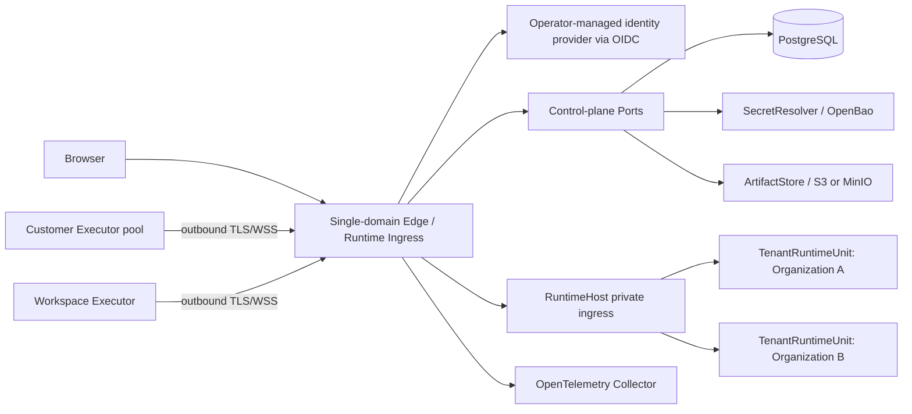

# Private Cloud Enterprise Architecture Contract

Status: normative

This is the normative **enterprise target**, not a statement that every requirement is present in the current installation or production-certified. It supersedes historical first-release one-user/no-RBAC assumptions in the [Runtime implementation record](./private-cloud-runtime-units.md); that record now describes the Organization model for current scope. Canonical naming and deployment configuration are defined by the [deployment-mode contract](./deployment-mode-contract.md). For what is implemented by default, experimental, or supported by release evidence, consult the [design/status ledger](./private-cloud-design-status.md).

## 1. Topology



The public product has one Origin. Tenant routing is server-derived and never encoded in a required subdomain, tenant URL, or browser-controlled header. Identity-provider operator administration may use a separate operator-only endpoint.

### Private Cloud persistence and deployment invariant

Every customer-deployable Private Cloud topology, whether on a customer-operated cluster or public-cloud infrastructure, must keep **all authoritative application state outside the Gateway and Runtime nodes**. Transactional control and Runtime state belongs in PostgreSQL; object bytes belong in an S3-compatible object store. Introduce another durable service only for a demonstrated data/access requirement, with its own recovery contract. A local directory, Docker named volume, NFS-mounted Unit tree, or Kubernetes persistent volume mounted on an application node is **not** an alternative authority for Sessions, Queue, artifacts, placement, audit, or identity. Nodes may use bounded disposable scratch/cache, but replacing any application node must not lose acknowledged work. A message containing an uploaded object reference is not durably accepted until its attachment has a recoverable PostgreSQL reference protecting S3 bytes from pending-upload expiration or release. Queue admission must never precede that protection; if reference protection succeeds but admission fails, retain the object rather than risk deleting an acknowledged message. The production target additionally requires a shared transaction or durable reconciliation protocol to reclaim such unconsumed protected objects without racing admission. A user-facing capability whose output, initial state, or success receipt still depends on a local-only file must fail closed in Private Cloud until its authority is migrated; it must not return a path in disposable scratch as a durable artifact. PostgreSQL and object storage themselves need durable, replicated operator-managed storage; this rule does not prohibit their implementation from using disks.

Self-managed and cloud-managed infrastructure are interchangeable only when they satisfy the same protocol, isolation, credential, backup/restore, and failure contracts. A cloud service name is not an implicit adapter: Azure Blob, for example, does not satisfy the S3 API without a separately implemented and accepted `ArtifactObjectStore` adapter. The current single-machine Compose/volume release is a legacy installation, **not** a compliant instance of this target; do not recommend it as the Private Cloud HA/scaling architecture or convert existing installations in place by deleting their volumes. The Dedicated mode is outside this Private Cloud change.

## 2. Authority matrix

| Fact | Sole authority | Runtime projection |
|---|---|---|
| Human authentication, MFA, federated identity | Operator-managed OIDC identity provider (ZITADEL is one option) | OIDC identity claims validated by Gateway |
| Organization, membership, role, contract state | PostgreSQL control plane | short-lived authorization decision |
| Workspace grant and Tool Policy | PostgreSQL control plane | versioned Unit policy snapshot |
| Browser session and revocation | PostgreSQL session repository | HttpOnly opaque cookie |
| Runtime placement and lifecycle generation | control-plane placement repository | Host materialization record |
| Session/Event Log/Queue/PendingCall | Tenant-scoped transactional PostgreSQL Runtime stores | Dashboard projection |
| Executor machine identity and credential status | control-plane Executor repository | Unit-local authenticated connection |
| Secret value | SecretResolver | ephemeral server-side value only |
| Artifact object bytes | S3/MinIO | tenant-scoped metadata and signed URL |
| Usage and audit | append-only PostgreSQL ledgers | query/read models |

No lower layer may silently create a missing higher-layer resource. In enterprise mode, first login cannot auto-create an Organization.

## 3. Identity and authorization

- A principal is `(issuer, subject)`; email is profile data, not identity.
- Browser cookies are opaque, HttpOnly, `SameSite=Lax`, Secure in production, idle-expiring, absolute-expiring, remotely revocable, and rotated when privilege changes.
- Authentication failure is `401`; an authenticated principal lacking permission is `403`. Document navigation may redirect to login only for authentication failure.
- Organization roles are fixed Owner/Admin/Member/Viewer for the first enterprise release. Workspace grants can narrow but never broaden Organization authority.
- Runtime HTTP reads require `runtime:read`; mutation and Dashboard Socket.IO require `runtime:write`; workspace administration requires `workspace:manage`.
- Membership suspension, Organization suspension, contract expiry, token revocation, and Executor revocation take effect on the next authorization check and terminate relevant live channels. Contract authorization is valid only for `starts_at <= now() < ends_at`; missing contracts deny access. `grace_ends_at` is an operator renewal window, not extra Runtime/API authorization. New-request checks alone cannot terminate already-open WebSocket channels. The current local Gateway rechecks browser session/role/contract and Executor invite route/contract on open connections and closes both proxy ends when invalid; Runtime device-credential revocation and cross-component/customer-network behavior still require end-to-end verification before this contract is claimed complete.
- The last Owner cannot be removed or demoted without an atomic Owner transfer.

## 4. Routing and service trust

1. Edge authenticates the browser or machine principal.
2. Edge resolves Organization, Workspace, permission, contract state, and placement server-side.
3. Edge deletes external cookie/authorization/routing headers and writes trusted internal routing metadata.
4. RuntimeHost accepts traffic only from private ingress authenticated with a rotatable service credential; production should use mTLS in addition.
5. RuntimeHost resolves the trusted route to exactly one ready Unit generation.
6. A WebSocket/Engine.IO connection is pinned to that Unit for its lifetime.

Unknown, suspended, stale-generation, duplicated, or unplaced routes fail closed. Public clients cannot invoke the private lifecycle API.

## 5. TenantRuntimeUnit contract

One Organization maps to one logical TenantRuntimeUnit in the initial topology. A Unit owns separate instances and roots for:

- Socket.IO server/namespaces and recovery buffers;
- Session/Event Log, Queue, operation dedupe, Approval and Compact state;
- Executor registry, pending dispatches and execution receipts;
- Artifact registry, push subscriptions, caches, timers and background work;
- Workspace metadata and versioned policy projection.

Cross-Organization identifier collision is expected and safe. Unit identity must be present in every persistent key, object prefix, metric context, and control operation. Unit-local code never receives an end-user credential or identity-provider token.

Lifecycle is generation-fenced:

```text
provisioning -> ready -> draining -> suspended -> closed
                     \-> failed
```

Provision, suspend, resume, drain, move, and delete require an idempotent `operationId` and monotonically increasing generation. In exclusive placement, exactly one fenced Host lease may write a Unit generation. The scalable target permits multiple healthy Runtime replicas to serve one logical Unit concurrently, but each mutable Session/Task/resource has one fenced owner at a time; stale owners cannot publish or commit, and the route to an established Engine.IO connection stays pinned until reconnect. A Unit-wide lease must not prevent safe parallel work on **different** Sessions. Drain rejects new work, checkpoints recoverable Agent work, waits within a bounded deadline, and exposes explicit incomplete work.

## 6. Customer Executor contract

Executor is a machine principal distinct from humans and service accounts.

- Enrollment uses a one-time hashed token with Organization/optional Workspace realm, expiry, use count, intended pool, and approving actor.
- Successful enrollment exchanges the token for a long-lived device identity plus short-lived runtime credentials. The raw enrollment token is never stored.
- Connections are customer-initiated outbound TLS/WSS. No platform-initiated inbound access to customer networks is required.
- Dispatch identity is `(organizationId, workspaceId, sessionId, callId, operationId)`; receipts and retries are scoped to that identity.
- ACK, reconnect, duplicate suppression, cancellation, late-result rejection and backpressure are mandatory.
- Revocation and drain terminate assignment immediately; in-flight work follows explicit cancellation/recovery policy.
- Proxy and customer CA settings are Executor-local. Diagnostics redact credentials and customer content.

Organization pools may serve authorized Workspaces; Workspace-dedicated pools cannot escape their Workspace.

## 7. Data contract

- PostgreSQL stores control metadata, authorization, lifecycle, append-only usage/audit, browser sessions, outbox and object metadata.
- Tenant runtime data stays under an Organization-scoped root or storage namespace. Session semantics remain deployment-mode neutral.
- Object keys begin with an opaque Organization identifier and resource class; signed URLs are short-lived and permission checked before issuance.
- Secrets are stored as `credentialRef`, never plaintext database columns, logs, audit payloads or browser responses.
- Audit records store actor, action, target identifiers, decision/result, time, request/trace ID and safe change metadata—not prompts, secrets, file bodies or Tool output.
- Retention and deletion are asynchronous, idempotent, observable and produce deletion evidence. Backups have a documented expiry and are not silently rewritten.

## 8. Network contract

| Path | Direction | Exposure | Authentication |
|---|---|---|---|
| Browser → Edge | inbound | public product Origin | browser session/OIDC |
| Executor → Edge | outbound from customer | public machine endpoint | device credential + TLS |
| Edge → RuntimeHost | private | internal only | service credential + production mTLS |
| Control plane → PostgreSQL/SecretResolver/S3-compatible store | private | internal only | workload-specific credential |
| Services → OTel Collector | private outbound | internal only | network/workload policy |
| Operator → ZITADEL admin | operator path | not product routing | ZITADEL operator auth |

Production TLS terminates at managed ingress. Internal HTTP is permitted only on isolated private networks with authenticated service boundaries. Neither RuntimeHost nor PostgreSQL is publicly exposed.

## 9. Failure and consistency contract

- Authorization defaults deny when identity, policy, contract, placement, or repository dependencies are unavailable.
- Agent Event Log and Queue durability remain first-persist-then-publish/delete.
- Control-plane mutations are transactional; external effects use an Outbox and idempotent consumers.
- Cached authorization carries a short bounded lifetime and a version; revocation signals close live channels.
- Runtime restart recovery deduplicates committed operations using operation IDs and Executor receipts. An already-dispatched external effect with no confirmed receipt remains **unknown** until reconciled; leases and database fencing alone cannot make an uncooperative LLM, tool or customer system exactly-once. Retry must follow the effect's idempotency contract and surface an explicit incomplete/unknown state rather than silently repeating it.
- A degraded product shows an actionable error and trace ID; it never presents an infinite loading state for 401/403/5xx.

## 10. Composition roots and Ports

Vendor dependencies terminate at explicit Ports:

- `IdentityProvider` / `FederationAdmin`
- `ControlPlaneRepository`
- `SecretResolver`
- `ArtifactObjectStore`
- `TelemetrySink`
- `SupportTicketAdapter`
- optional `PolicyDecisionPoint`

Dedicated composes local adapters and one `local` Unit in the current systemd installer. The Private Cloud **enterprise target** composes PostgreSQL, identity, secrets, S3-compatible objects and OTel through these Ports; this is not a claim that every adapter or service ships in the current beta Compose. Kernel, Session, Queue, Compact, Tool and Executor protocol code cannot read deployment environment variables or import those vendor SDKs directly.

## 11. Acceptance invariants

- Two Organizations can reuse every client-visible identifier without data, socket, artifact, receipt, notification or metric leakage.
- Viewer cannot establish a mutating Dashboard socket.
- Revoked human and Executor credentials cannot reconnect or reuse existing channels.
- A stale lifecycle generation cannot publish or write a Unit.
- Direct RuntimeHost access without service trust fails closed.
- Dedicated retains Workspace/File/Git/Executor and all Agent semantics; Private Cloud removes Benchmark/Evaluation at UI and server capability boundaries only.
- Backup/restore, migration, upgrade and deletion are proven in disposable environments before release.
