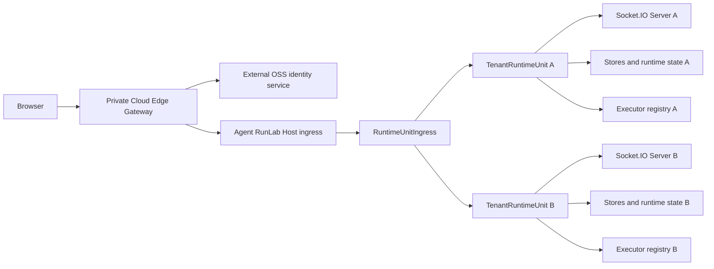
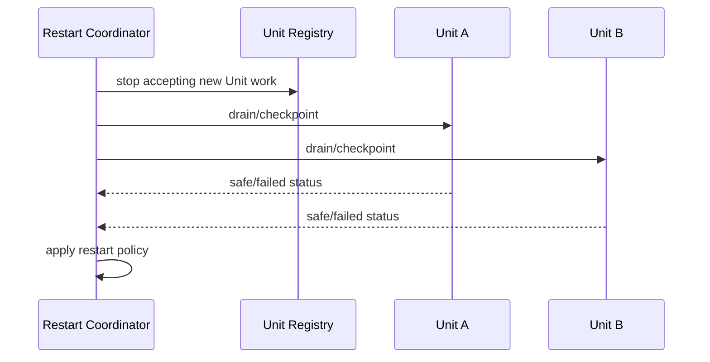

# TenantRuntimeUnit and Private Cloud Architecture

**Status:** accepted Runtime architecture; Phases 0–6 implemented for the local single-node Private Cloud composition; Phase 7 partial. Enterprise Organization/RBAC requirements are governed by the [enterprise architecture contract](./private-cloud-enterprise-architecture-contract.md), not the historical first-release assumptions in this record. For target-versus-delivered scope and evidence, see the [design/status ledger](./private-cloud-design-status.md).
**Normative mode contract:** [`deployment-mode-contract.md`](deployment-mode-contract.md)
**Decision:** the canonical name is `TenantRuntimeUnit`
**Scope:** Host-internal multi-tenant isolation and the user-operated Private Cloud control plane; the same Platform architecture supports Dedicated through `single-tenant` configuration
**Multi-node end state:** target architecture only; not implemented by the current composition or the completed phases recorded below

## 1. Goal

Agent RunLab exposes three products from two runtime architectures:

1. **Portable:** direct single-file execution.
2. **Dedicated:** Platform with `single-tenant` tenancy.
3. **Private Cloud:** Platform with `multi-tenant` tenancy.

The Host must remain independent of end-user identity systems. It must not implement registration, login, passwords, OIDC/JWT user verification, organization membership, or RBAC. Those concerns belong to an external Private Cloud Gateway/Control Plane. The Host may still verify deployment-boundary credentials: the existing Dedicated shared token and a Private Cloud Gateway/control-plane service credential. This is service authentication, not user authentication.

The Host's multi-tenant abstraction is `TenantRuntimeUnit`: one complete, isolated Agent runtime owned by one tenant.

## 2. Non-negotiable boundaries

### 2.1 Host knows runtime tenancy, not user identity

The Host may know:

- `tenantRuntimeUnitId`
- an opaque `routingKey`
- Unit lifecycle and capabilities
- Unit-scoped sessions, artifacts, workspaces, executors, queues, caches, and sockets

The Host must not know:

- user email, password, profile, or login session
- Google/GitHub identity
- ZITADEL, OIDC provider, or identity-provider subject
- user-to-tenant membership or roles
- billing identity

The external control plane decides which authenticated user maps to which Unit. The Host receives only a trusted routing decision.

### 2.2 Isolation is structural

Isolation must not rely on callers remembering to add `tenantId` to every Room or Store call. Each Unit owns separate instances of tenant-sensitive services and receives a private storage root.

### 2.3 Socket.IO Rooms are not the tenant boundary

Each Unit has its own Socket.IO server and therefore its own namespaces, adapters, connection recovery state, and Room namespace. Rooms remain useful inside a Unit for `session:<id>` and workspace routing, but do not implement cross-tenant isolation.

### 2.4 One codebase, no Private Cloud fork

Dedicated and Private Cloud share Kernel, Host loop, Dashboard, Agent/Executor protocols and domain behavior. The current single-node composition uses Session JSONL and local Artifact storage; the enterprise Private Cloud target replaces these persistence authorities with tenant-scoped transactional state and S3-compatible object bytes through storage Ports. Sharing domain semantics does **not** require shipping JSONL or a Unit directory as the HA authority.

### 2.5 Feature disabling is authoritative

In Private Cloud mode, Benchmark/Evaluation are absent from Dashboard navigation and cannot be invoked through Host HTTP or socket endpoints. UI hiding alone is insufficient.

## 3. Target topology



The identity service is replaceable. A self-hosted ZITADEL deployment is one possible Private Cloud choice, but no ZITADEL dependency belongs in `packages/host`.

## 4. Core concepts and naming

### 4.1 `TenantRuntimeUnit`

A `TenantRuntimeUnit` is the complete in-process runtime boundary for one tenant.

```typescript
export interface TenantRuntimeUnit {
  readonly id: TenantRuntimeUnitId
  readonly state: TenantRuntimeUnitState
  readonly capabilities: RuntimeCapabilities
  readonly io: SocketIOServer
  readonly store: SessionStore
  readonly sessionArtifacts: SessionArtifactRegistry
  readonly executors: ExecutorRegistry
  readonly loop: LoopHandle

  start(): Promise<void>
  drain(input: DrainInput): Promise<DrainResult>
  close(): Promise<void>
}
```

This interface is illustrative. Implementation should expose the smallest surface needed by routing and lifecycle code; mutable internals should not become public simply to match this sketch.

A Unit owns separate instances of:

- Socket.IO server, `/dashboard` and `/executor` namespaces, adapter, Rooms, and recovery buffers
- SessionStore and active Agent state
- Host loop and token-delta batching
- SessionArtifactRegistry
- workspace alias and executor registries
- message queue and operation deduplication state
- push subscriptions and notification transition state, if Private Cloud retains those features
- Unit-scoped caches, timers, hooks, and background work
- Unit-scoped configuration projection

A Unit must not access another Unit's instances or root directory.

### 4.2 `TenantRuntimeUnitRegistry`

Owns loaded Units and serializes creation:

```typescript
interface TenantRuntimeUnitRegistry {
  get(id: TenantRuntimeUnitId): TenantRuntimeUnit | undefined
  getOrLoad(route: TenantRuntimeUnitRoute): Promise<TenantRuntimeUnit>
  provision(spec: TenantRuntimeUnitSpec): Promise<TenantRuntimeUnit>
  drain(id: TenantRuntimeUnitId): Promise<DrainResult>
  close(id: TenantRuntimeUnitId): Promise<void>
  list(): readonly TenantRuntimeUnitSummary[]
}
```

It requires separate `loaded` and `loading` maps so concurrent first requests cannot create duplicate Units.

For the first single-Host Private Cloud release, the external Control Plane is authoritative for whether a tenant exists and its desired lifecycle state; the Host catalog is a durable local materialization used for restart and reconciliation. The catalog must contain a schema version, Unit ID, expected routing-key digest/version, lifecycle generation, desired state, data-root identity, capabilities, and last successfully applied control-plane operation ID. Provision/suspend/delete are idempotent generation-checked operations written atomically before a Unit is published. On restart the Host reports its materialized generations and reconciles them with the Control Plane before accepting tenant traffic.

The local catalog is explicitly not a multi-node placement authority. Exclusive-v1 placement fences one Host writer for a Unit generation; the future parallel target may admit multiple Runtime replicas in one Unit while fencing writes by Session/Task/resource owner. Neither protocol lets a second Host infer ownership from copied catalog files. See the [enterprise contract](./private-cloud-enterprise-architecture-contract.md#5-tenantruntimeunit-contract) and section 9.1 for the target versus the operator-gated experiment.

### 4.3 `TenantRuntimeUnitFactory`

Builds one Unit from explicit dependencies and a private root:

```typescript
createTenantRuntimeUnit({
  id,
  dataRoot,
  capabilities,
  runtimeConfig,
  socketTransport,
})
```

The factory must reject invalid IDs and any root escaping the configured tenant-data directory.

### 4.4 `RuntimeUnitIngress`

Routes an already trusted request or connection to a Unit. It does not authenticate users, resolve memberships, or provision accounts.

Its semantic input is:

```typescript
type TenantRuntimeUnitRoute = {
  readonly unitId: TenantRuntimeUnitId
  readonly routingKey: string
}
```

The external Gateway owns user-to-route mapping. The Host owns route-to-Unit dispatch.

`routingKey` is the only ingress lookup value; `unitId` is the resolved internal identity and is never accepted independently from a browser request. The Host catalog stores a one-way digest plus version of the routing key and resolves it to exactly one Unit. Key rotation creates a new version, permits a bounded drain window for the prior version, and then revokes it. Unknown, revoked, duplicated, or mismatched routes fail closed. The key is an opaque routing secret but is not sufficient protection without private ingress and service authentication.

### 4.5 Control-plane adapter

The Host exposes a private provisioning/lifecycle API through a narrow adapter. It is distinct from end-user Agent APIs:

```text
provision Unit
inspect Unit readiness
suspend/resume Unit
drain/delete Unit
query aggregate health
```

Service-to-service trust is deployment infrastructure, not user authentication. The Host should normally be unreachable from the public Internet; private networking and preferably mTLS protect this API. The Host verifies the Gateway/control-plane service identity but never processes end-user identity claims. It must never trust a public browser-supplied `X-Tenant-ID` header.

## 5. Dedicated composition

Dedicated creates exactly one Unit:

```text
Host process
└── TenantRuntimeUnit(local)
```

Properties:

- no Private Cloud Gateway or identity provider required
- existing shared-token behavior remains available
- existing URL and Dashboard bootstrap remain compatible
- all current features remain enabled
- existing Session data remains readable
- all HTTP and Socket.IO ingress routes implicitly to `local`

Dedicated is not a separate implementation. It is a single-Unit composition with a fixed route.

```typescript
const deployment = {
  schemaVersion: 1, architecture: 'platform', tenancy: 'single-tenant', runtimeProfile: 'full',
}
```

## 6. Private Cloud composition

Private Cloud creates Units as directed by the external control plane:

```text
Private Cloud Gateway
└── shared Host process
    ├── TenantRuntimeUnit(01...A)
    ├── TenantRuntimeUnit(01...B)
    └── TenantRuntimeUnit(01...C)
```

The Gateway is responsible for:

- registration and login integration
- authenticated browser sessions
- resolving authenticated Organization membership and Workspace authorization to the Organization's logical Unit
- keeping all tenants on one product Origin
- resolving the authorized Organization to an opaque internal Unit route
- provisioning, suspending, and deleting Units
- proxying HTTP, polling, WebSocket upgrade, and static Dashboard traffic
- contract state, entitlements, and Organization lifecycle under the enterprise control-plane contract

The Host is responsible for:

- isolating runtime state by Unit
- running Agent sessions
- storing Unit-scoped data
- routing Unit-scoped executor connections
- lifecycle, restart, health, and resource governance

Current single-node topology and enterprise scope:

- one Organization (not one user) maps to one logical `TenantRuntimeUnit`; its members have Owner/Admin/Member/Viewer roles and Workspace grants defined by the [enterprise contract](./private-cloud-enterprise-architecture-contract.md)
- no cross-Organization data access; a user cannot select another Organization by supplying a Unit route
- Organization/contract provisioning is operator-controlled; first login never auto-creates an Organization
- Agent functionality is enabled; Benchmark and Evaluation are disabled
- the current default runs all Units in one Host process, with process-level failure shared across Organizations

The original one-user/no-RBAC assumptions described a discarded first-release scope, **not** the current Private Cloud product contract. Enterprise Pilot acceptance and multi-node readiness are separate from the completed single-node Runtime phases.

## 7. Product Origin and trusted routing

All users enter the same product Origin:

```text
https://runlab.example.com
```

The URL does not contain a tenant slug, hostname, routing key, or Unit ID. The Gateway stores and resolves:

```text
authenticated issuer + subject -> Organization membership + Workspace authorization + placement -> opaque Unit ID
```

The browser does not choose the Unit ID. For every HTTP request, Engine.IO poll, and WebSocket upgrade, the Gateway validates the revocable browser session, resolves Organization membership, Workspace authorization, contract and placement, strips caller-supplied routing headers, and proxies a trusted route to private Host ingress.

Recommended trust model:

1. Host is reachable only from Gateway and trusted executors/control-plane services.
2. Gateway binds one authenticated browser session to one immutable Unit route.
3. The internal route is protected by private networking and mTLS or an equivalent service credential.
4. Host resolves that route through `RuntimeUnitIngress`.
5. A connection cannot change Units after Socket.IO/Engine.IO handshake creation.

An opaque routing key alone is not sufficient authorization if Host is publicly reachable.

## 8. Socket.IO and Engine.IO design

### 8.1 Required outcome

Each Unit must own an independent Socket.IO server:

```text
TenantRuntimeUnit A / Socket.IO A
├── /dashboard
└── /executor

TenantRuntimeUnit B / Socket.IO B
├── /dashboard
└── /executor
```

Consequences:

- identical namespace names are safe
- identical `sessionId`, `workspaceId`, and Room names are safe across Units
- connection recovery and ACK state are Unit-local
- closing Unit A does not close Unit B

### 8.2 Engine.IO routing constraint

Socket.IO includes multiple HTTP requests and an upgrade sequence, not just one WebSocket:

```text
GET polling handshake
POST polling packets
GET polling responses
WebSocket upgrade
reconnect/recovery attempts
```

Every request belonging to one Engine.IO session must reach the same Unit. This must be proven before the Host is refactored around it.

### 8.3 Mandatory prototype gate

Before production implementation, build a two-Unit transport prototype that validates both:

- multiple Socket.IO servers attached through a shared Host ingress
- independent Unit closure and recovery

Required tests:

- polling-only connection to A and B
- WebSocket-only connection to A and B
- polling-to-WebSocket upgrade
- ACK and `emitWithAck`
- connection-state recovery and forced reconnect
- identical namespaces, Room names, session IDs, and workspace IDs
- concurrent streaming in A and B
- closing/draining A while B remains active
- malformed/unknown route rejection before Engine.IO accepts a session
- route mismatch on later polling/upgrade requests
- graceful process restart across both Units

### 8.4 Transport decision

The Phase 0 source audit and executable feasibility test reject direct attachment of multiple independently managed Socket.IO servers to one Node HTTP server.

In the locked Socket.IO 4.8.3 / Engine.IO 6.6.9 implementation:

- Engine.IO attachment snapshots and removes all HTTP `request` listeners, then installs a wrapper that replays earlier listeners.
- each attachment appends an `upgrade` listener; with default `destroyUpgrade`, one instance may schedule destruction of another path's upgrade.
- Socket.IO exposes no detach operation and Engine.IO close does not restore captured listeners.
- `io.close()` closes the supplied Node HTTP server, so one Unit cannot close independently.

The regression proof is `packages/host/src/socketio-shared-http-feasibility.test.ts`. It demonstrates that distinct paths can incidentally carry polling/WebSocket/ACK while both instances remain attached, but independent close shuts the shared listener and Engine.IO close leaves listeners installed. Incidental coexistence is not an acceptable lifecycle contract.

**Chosen production transport:** every Unit owns one internal Node HTTP server with its Socket.IO server attached in the standard one-to-one form. It listens on a Host-private Unix-domain socket where supported, with loopback ephemeral TCP as the portability fallback. `RuntimeUnitIngress` is the sole public ingress and reverse-proxies HTTP polling and WebSocket upgrade to the selected internal listener.

This adds one internal listener per loaded Unit but gives standard Socket.IO lifecycle, independent close, and no dependency on undocumented listener chaining. Internal listeners are never public tenant ports.

Do not silently fall back to one shared Socket.IO server with tenant-prefixed Rooms; that is a different architecture and requires an explicit design decision.

### 8.5 Connection-route binding and sticky routing

The Host ingress owns an ephemeral `engineSid -> { unitId, routingKeyVersion }` binding created only after the target Unit accepts the Engine.IO handshake. Later polling POST/GET and upgrade requests resolve through that binding and reject any conflicting route. Bindings expire when Engine.IO closes or its recovery horizon expires; they are never reconstructed from browser input. Unit suspend/delete invalidates new handshakes and drains or terminates existing bindings according to lifecycle policy. After a Host process restart, clients perform a new trusted route handshake; the Host does not pretend that in-memory Engine.IO bindings survived.

The Gateway and Host route must remain stable for the full Engine.IO connection. In exclusive placement the whole Unit routes to one Host; in the scalable target independent Sessions may have different owners, so established sockets stay pinned to their authenticated owner and clients reconnect through server-derived placement after takeover. A distributed Socket.IO adapter is an alternative only if it preserves the same authorization, isolation and recovery contract; none of this is part of the current release.

## 9. Storage isolation

Current single-host `local-volume` layout (not the multi-node storage target):

```text
data/
├── host/
│   └── runtime-unit-catalog.json
└── tenant-runtime-units/
    ├── 01...A/
    │   ├── sessions/
    │   ├── session-artifacts/
    │   ├── workspace-aliases.json
    │   ├── push-subscriptions.jsonl
    │   └── runtime/
    └── 01...B/
        └── ...
```

Rules:

- Unit IDs are generated and validated internal identifiers, never emails or hostnames.
- Every Unit receives one canonical root path from the Factory.
- Stores receive paths beneath that root and do not accept caller-selected storage roots.
- Artifact reads require a session in the same Unit, preserving the existing session-bound rule.
- Workspace and Executor lookup occurs only in the Unit's registries.
- Global process caches may contain only immutable shared assets or entries explicitly keyed by Unit ID.
- For the single-host local-volume profile, backups, retention, export and deletion operate on a Unit root, with deletion requiring a drained Unit. In the enterprise target these operations span transactional PG state, object versions, control-plane records and secrets; a copied Unit directory cannot be treated as a complete backup or migration.

### 9.1 Final multi-node target (not current behavior)

The final Private Cloud target changes the physical realization of a Unit without
changing its logical isolation contract. `TenantRuntimeUnit` becomes a logical
identity, authorization/policy namespace, and state namespace; it is not pinned
to one Runtime process, Pod, Kubernetes node, local directory, or persistent
volume. Session and Task work for that Unit may be placed on any eligible
Runtime replica, subject to the ownership rules below.

This is an explicit future target, not a description of the repository today.
The default Private Cloud Compose `runtime-host` mounts `tenant-data`, and the
Runtime service creates a directory for each Unit beneath its configured data
root. That beta composition remains local and single-node. A separate opt-in
single-Runtime [PG/S3 evaluation profile](../operations/private-cloud-postgres-s3-profile.md)
replaces this Runtime volume with bounded tmpfs scratch and operator-managed PG/S3;
it is not a release upgrade or HA acceptance. The opt-in
experiment below adds transactional PostgreSQL state, S3 objects, Gateway live
Unit placement and database-level fencing; the operator-gated `parallel-v1`
variant has demonstrated simultaneous **different-Session** work on two real
Runtime processes in isolated Docker. This limited test is not general Task
placement, Kubernetes node-loss recovery, browser reconnect continuity or
storage-independent production failover. Each remaining indirect write path
and external side effect must be audited before claiming that goal.

#### Current implementation progress and experimental acceptance (2026-10-19)

The repository now contains an **experimental, opt-in** slice toward this target:

- PostgreSQL stores a Session latest projection and an append-only audit trail.
  New audit rows contain replayable deltas rather than another whole Session
  document, and old snapshot rows remain readable. The latest projection is
  still rewritten as a whole on mutation, so its PostgreSQL WAL/TOAST write
  amplification has **not** been shown to scale linearly with Session length.
- PostgreSQL also stores the Runtime materialization catalog and a Unit ownership
  lease. Queue claim has a durable `unknown` shell for work whose outcome cannot
  yet be established safely after an interruption. Experimental HotState SQL
  runs inside transactions that check the active Unit placement token and
  generation under a row lock, so a stale owner cannot commit a PostgreSQL
  mutation after another owner takes over; this does **not** fence already
  dispatched external tool calls or S3 effects. Experimental Unit assembly
  uses PostgreSQL for DAGs, scheduled tasks, workspace aliases, Executor
  installations, hashed Executor pairing identities/invites, encrypted Push
  subscriptions, Memo and provider credentials. The opt-in PG/S3 Unit does not
  launch a loopback Executor: a durable external Executor and workspace are
  required for filesystem tools, and its own receipt store remains that
  Executor's responsibility. Without one attached, those tools cannot run.
  Push requires externally provisioned VAPID keys; without a complete key pair,
  the experimental Runtime explicitly disables Push instead of generating a
  local private key. Subscription mutations serialize across Runtime clients.
- Attachments and Artifacts can use S3-compatible object storage. Their
  uploads now record a tenant-scoped PostgreSQL intent before the S3 write;
  metadata publication atomically consumes that intent. Bounded startup
  reconciliation and periodic Unit-local passes can fence and delete known
  orphaned objects. Operator migration v6 persists an upload-intent lease and
  exact Session owner generation: pending uploads remain protected while the
  owner is live and stale generations become eligible for cleanup. Ambiguous
  late S3 puts require durable deleting tombstones; those tombstones cannot yet
  be garbage-collected
  without resolving late-upload races. A tenant-scoped PostgreSQL capacity
  ledger atomically reserves Artifact and attachment bytes before S3 upload;
  usage persists across Runtime replacement. Ambiguous upload failures retain
  conservative allocations until safe operator reconciliation, so the quota
  may temporarily block further uploads rather than undercount S3 objects.
  For a PG/S3 Session, every user-facing deletion path must first persist an
  owner-fenced `delete_requested` tombstone, **before** queue cancellation,
  Executor cleanup, Runtime hooks or S3 deletion. The Gateway must distinguish
  this terminal state from a retryable owner relocation and never prepare a new
  route for a deleting Session. A bounded Unit-local recovery pass may acquire
  a newer owner generation and retry idempotent object cleanup, then commit the
  final owner-fenced deletion. A process restart is not a prerequisite for
  recovery. This does not make tree deletion atomic or retract an already
  dispatched external effect; each Session's tombstone is its own durable
  boundary. Object registration is
  fenced once deletion starts. Reusing the same Session ID after deletion is
  intentionally unsupported until old writers can be proven terminated.
  The Runtime in this mode does not start its local-file restart coordinator;
  the external orchestrator must replace Pods and retry safe work.
- The Gateway has a Unit-origin resolver and requires explicit Runtime
  bootstrap; a Runtime is not selected merely because its process is reachable.
  PostgreSQL v3 primitives support multiple live replica memberships per Unit
  and fenced Session/Task owners. The experimental Runtime now registers,
  renews, and releases its own replica membership after acquiring Unit placement.
  The default placement remains exclusive; operator-migrated schema v5 additionally
  permits a separately gated experimental `parallel-v1` barrier that excludes
  old exclusive writers. Membership loss closes the affected Runtime Unit;
  replica presence alone authorizes no Session/Task execution.
  With `KALA_RUNTIME_EXPERIMENTAL_SESSION_OWNERSHIP=1` and an operator-migrated
  PostgreSQL schema, the Runtime now obtains/renews trusted Session owners on
  demand before SessionAuthority mutations, missing-projection repairs or PG
  queue operations; read-only Session listings do not acquire owners. It checks
  the owner inside the associated write/queue transaction and releases owners
  on Unit close. Lost owner renewal closes that Unit; stale membership hides
  its owner immediately. The in-process Session/Task owner manager has acquire,
  renew, fail-closed loss callback, and release tests. Operator gate v5 uses a
  permanent placement barrier and a feature-version row writable only by the
  schema operator; Runtime credentials can read but cannot enable it. Legacy
  exclusive writers cannot acquire or take over the permanent barrier. Only
  the operator-gated `parallel-v1` path allows multiple members to load a Unit;
  the default remains exclusive. The gate row and barrier are immutable even to
  normal schema-operator DML after activation: never `UPDATE`, `DELETE` or
  `TRUNCATE` either table to roll back live replicas. Drain all replicas, preserve
  backups, and use a separately reviewed schema migration for any protocol
  transition; direct owner-level DDL/superuser changes bypass these triggers and
  are outside this safety guarantee. SQL takeover regressions reject stale Session
  owner generations while unrelated Sessions remain owned by different replicas.
  These owner primitives alone still do not make every Session RPC or external
  execution safe for multi-node production.
  HotState event/projection writes now accept an **optional**, exact
  Session/Task owner lease and check it in the same PG
  transaction before appending, including idempotent retries; isolated PG
  tests reject stale owner writes. SessionAuthority can now optionally obtain
  the live owner from a server-side provider and fence audit/projection writes,
  idempotent retries, and projection repair. In the same opt-in mode its
  PostgreSQL message queue fences reads, enqueue, claim, confirm, renew,
  complete, release, and migration imports within Session owner transactions;
  an isolated
  PostgreSQL takeover test rejects old Session and queue writes even while the
  old in-memory owner TTL remains unexpired. The opt-in Runtime also configures
  this owner provider for its shared Artifact/attachment object metadata and
  capacity ledger. Object intent creation, deletion tombstones, metadata
  append (including idempotent replay), intent cleanup, and byte reservations
  now check the live Session owner inside their respective PostgreSQL
  transactions. The object HotState event retains its task-like `object:<id>`
  scope and adds a separate Session owner check; it must not confuse the two
  leases. Background orphan reconciliation remains tenant-wide and uses
  claim/tombstone rules rather than asserting one Session owner before S3
  deletion. Lost-owner compensation can still leave conservative allocations
  or ambiguous S3 effects, so this is **not** an exactly-once external-effect
  guarantee. With opt-in enabled, Kernel model/tool dispatch, compaction,
  Dashboard cancellation RPCs and Copilot SDK model send / Host-dispatched
  tools check owner, live membership and Unit placement before new effects.
  Unit closure aborts active cancellable model/tool calls before queue shutdown.
  Distributed owner takeover does not automatically replay model/tool work
  with an unknown outcome: a model becomes `[interrupted]` and a pending tool
  awaits explicit reconciliation. A remote destination may ignore cancellation
  or already have performed an effect; only external receipts/idempotency can
  make that effect exactly-once.
  DAG mutation and idempotent replay now check the parent Session owner inside
  the locked Unit JSONB row transaction. Scheduled tasks check affected Session
  owner on writes, claim and recovery. In `parallel-v1`, scheduled state can be
  shared by replicas; a single scheduler leader tries to assign unowned work,
  while effects run only for locally owned Sessions and ambiguous outcomes are
  retained for review. The Unit-wide JSONB rows remain serialization hot spots.
  Dashboard and Public API Session-tree deletion precheck every descendant's
  owner before doing external cleanup; this precheck cannot fence a remote
  effect already started or make an entire multi-Session deletion atomic.
  Dashboard workspace command execution, directory creation, background kill,
  terminal create/input/resize/kill, and memory consolidation now recheck the
  live Session owner immediately before dispatching to an Executor or model.
  Temporary terminal IDs resolve to the real Session owner. For parallel-v1,
  workspace-only mutations on a multiplexed control socket fail closed because
  they cannot identify a unique owner; directory picking before a Session is
  bound remains supported only in dedicated mode without tenant ingress.
  Socket.IO stale-owner regressions assert no Executor/model dispatch, and the isolated Docker
  two-Runtime takeover regression still passes; the Docker scenario does not
  independently exercise every external-effect RPC after takeover. Other
  indirect RPCs and non-transactional side effects still require audit.
  This optional mode requires a trusted Unit ID and an operator-migrated schema;
  v5 adds the mixed-version barrier and v6 adds upload-intent leases, but neither
  proves every-write owner
  enforcement or production-safe external effect recovery. Operator migration
  v4 also adds a unique index on
  `(organization_id, resource_type, resource_id)` in resource ownerships:
  Session/Task hot-state and queue keys omit Unit ID, so two Units in one
  organization must never independently own the same resource ID. The index
  also applies to the development-only table bootstrap. When upgrading v3,
  first inspect any historical duplicate `(organization_id, resource_type,
  resource_id)` owner rows (for example, `SELECT organization_id, resource_type,
  resource_id, array_agg(unit_id ORDER BY unit_id) AS units FROM
  tenant_runtime_resource_ownerships GROUP BY organization_id, resource_type,
  resource_id HAVING count(*) > 1`) and reconcile their Unit assignment and
  associated data under a maintenance window/backup; v4 intentionally fails atomically
  on duplicates and **does not** pick a winner or erase rows. The unique row
  persists when a lease expires, so moving an ID to another Unit requires an
  explicit, fenced operator migration, not a silent lease retry. This does not
  remove the default exclusive placement; only operator-gated `parallel-v1`
  replaces it with the permanent barrier and owner-checked experimental path.
  Replica records from retired Pod identities are not yet garbage-collected;
  any retention job must preserve resource fencing generations and foreign-key
  constraints before a high-churn Kubernetes rollout.
  A read-only Gateway resolver can find trusted resource-owner origins.
  Opt-in Gateway WebSocket Upgrade now accepts short-lived signed v2 Session
  route tickets only for a currently authenticated, authorized organization
  member whose canonical principal, Unit and organization match the ticket;
  it rechecks the live owner and fails closed on invalid tickets. Gateway
  strips client-supplied routing headers and forwards the verified Session
  identity to Host, which rejects a different Socket.IO handshake Session,
  multiplexed control socket, explicit
  cross-Session RPC, or cross-Session channel subscription. This does not yet
  replace a full Session-scoped execution fence for every indirect RPC or tool
  side effect. The Gateway additionally exposes opt-in `POST /runtime/route-ticket`
  for a cookie-authenticated, active-organization member with `runtime:write`:
  same-origin JSON containing only `sessionId` yields a no-store ticket valid
  for at most 15 seconds (Upgrade verification tolerates at most two seconds
  of verifier clock lag; clocks still require synchronization), **only if** a
  live Session owner and replica already exist in the organization's Unit and
  its PostgreSQL latest Session projection
  exists, belongs to that organization, and is not deletion-tombstoned. Both
  issuance and Upgrade re-check these conditions. Unknown owners fail closed;
  clients cannot supply the principal, Unit or owner binding. The Gateway
  origin and resource owner readers require the separate, startup-audited
  `KALA_INGRESS_EXPERIMENTAL_POSTGRES_READER_CONNECTION_STRING` when tickets
  are enabled; the legacy Runtime placement credential must not remain in the
  Gateway environment. The operator CLI can grant a pre-created role SELECT
  on exactly five Runtime tables with `--gateway-runtime-reader-role`, but
  creation of that role, credentials and cross-database privilege hardening
  remain deployment responsibilities. The control-plane PG credential is
  separate and still has legitimate organization write access. The Host issuer
  remains an internal helper, not an authenticated Host endpoint. The opt-in
  experimental Runtime can now create a live owner for an accessed Session,
  which is a prerequisite for issuing its ticket; Task owner acquisition is not
  connected. An opt-in Dashboard client now requests a short-lived ticket for
  authenticated Private Cloud Sessions, connects a fresh WebSocket-only Session
  socket with the ticket in the Engine.IO query, and requests a new ticket after
  disconnection. Only an explicit `route_ticket_unavailable` response uses the
  legacy shared Unit socket; owner and authorization failures fail closed.
  If a pre-existing Session has no live owner, the client asks the authenticated
  Unit-affine control socket to validate and prepare its owner once, then retries
  ticket issuance. The server requires an existing authorized Session, a trusted
  organization-bearing control connection, and the opt-in owner check; failures
  never downgrade to the Unit socket. In default mode this acquires owners on
  the exclusive Unit leader; under the operator-gated `parallel-v1` protocol,
  the Gateway instead chooses a live allowlisted replica for Unit-affine control
  traffic while Session tickets still resolve to their exact live owner. Each
  new Session uses a fresh control socket and the least-loaded eligible replica
  by live Session/Task owners. An isolated real-Gateway acceptance with a
  browser-like Socket.IO client and actual cookie, Origin, HTTP ticket and
  WebSocket boundaries verifies automatic X/Y spread, exact owner proxying,
  SIGKILL reconnect and PG network-partition recovery. A single real external
  Executor, authenticated through Gateway and connected to both owners, also
  executed X/Y `read_file` calls with persistent workspace and receipts in
  the isolated Docker acceptance. An opt-in real headless Chromium check also
  verifies browser Cookie, Gateway ticket, routed WebSocket and X/Y PG-backed
  tool history. It exercises the browser transport, not the built Dashboard UI.

A Docker PostgreSQL + Silo acceptance experiment starts **two real Runtime
processes** and proves sequential takeover of the same Unit: only one Runtime
holds the Unit ownership lease at a time, the successor takes ownership after
release/expiry, and neither Runtime publishes a Host port. An additional
isolated SIGKILL drill verifies the successor waits for both the Unit placement
TTL and the independent PostgreSQL scheduled-task writer lease to expire before
restoring the Session and S3 attachment. A separate Docker network-partition
drill keeps A's process alive, disconnects it from PG, lets B take over, then
reconnects A and verifies that its stale Session write RPC is rejected. In
both drills the successor is the only live registered replica for this Unit.
The opt-in, versioned-schema variant has also passed graceful, SIGKILL and
network-partition drills with a real Session owner: the owner generation moves
from A's replica to B's, and the Session and S3 attachment recover. These
sequential-takeover results alone do not demonstrate simultaneous Session
placement, fencing of all possible external side effects, or automatic
Kubernetes node-failure recovery.
The isolated Runtime/PG/Silo acceptance drivers (the parallel driver also
starts a real Gateway; none publish Host ports) can be run from `packages/host` with:

```sh
KALA_RUN_PRIVATE_CLOUD_STORAGE_INTEGRATION=1 ./node_modules/.bin/vitest run src/tenant-runtime/private-cloud-storage.integration.test.ts
KALA_RUN_PRIVATE_CLOUD_STORAGE_INTEGRATION=1 KALA_TEST_PRIVATE_CLOUD_FORCE_KILL=1 KALA_TEST_PRIVATE_CLOUD_VERSIONED_SCHEMA=1 ./node_modules/.bin/vitest run src/tenant-runtime/private-cloud-storage.integration.test.ts
KALA_RUN_PRIVATE_CLOUD_STORAGE_INTEGRATION=1 KALA_TEST_PRIVATE_CLOUD_NETWORK_PARTITION=1 KALA_TEST_PRIVATE_CLOUD_VERSIONED_SCHEMA=1 ./node_modules/.bin/vitest run src/tenant-runtime/private-cloud-storage.integration.test.ts
# Operator-gated parallel-v1: real Gateway, two Runtimes, browser-like client,
# automatic X/Y placement, real external Executor read_file + receipts,
# SIGKILL reconnect and PostgreSQL network partition.
KALA_RUN_PRIVATE_CLOUD_STORAGE_INTEGRATION=1 ./node_modules/.bin/vitest run src/tenant-runtime/private-cloud-parallel-v1.integration.test.ts
# Additional real headless Chromium browser-engine check (pinned Puppeteer image):
KALA_RUN_PRIVATE_CLOUD_STORAGE_INTEGRATION=1 KALA_RUN_REAL_BROWSER_INTEGRATION=1 ./node_modules/.bin/vitest run src/tenant-runtime/private-cloud-parallel-v1.integration.test.ts
# Add both KALA_TEST_PRIVATE_CLOUD_VERSIONED_SCHEMA=1 and
# KALA_TEST_PRIVATE_CLOUD_SESSION_OWNERSHIP=1 to repeat any mode with Session owner acquisition.
```

Each invocation creates and removes its own UUID-labeled Docker containers,
internal network, tmpfs and test secrets; it requires `sudo -n docker` locally.
The separate earlier Compose experiment can be run from its Compose directory
with:

```sh
# Supply only disposable experiment values through its environment; no real
# production credentials are required or should be written into this document.
docker compose up --build --abort-on-container-exit
docker compose down --volumes --remove-orphans
```

The temporary resource model is one isolated Docker network, one disposable
PostgreSQL database, one disposable Silo service and bucket, one Gateway, and
two Runtime identities contending for one test Unit. Database/object-store
credentials are experiment-only environment values; Docker volumes, the bucket,
and all test rows are disposable and are removed by teardown. Only the Gateway
or the acceptance driver may publish a test-facing port; the two Runtime
containers remain reachable solely on the experiment network.

The older sequential takeover driver proves one Unit's **exclusive** owner
transition. Separately, the operator-gated `parallel-v1` acceptance starts two
real Runtime containers and a real Gateway on one internal Docker network.
A browser-like client creates X/Y via independent Gateway control sockets;
least-owner-loaded placement distributes them across replicas, and ticketed
WebSockets target the exact PG owner. After SIGKILLing X's owner, the client
reconnects through Gateway and writes X at owner generation 2. The dead replica
restarts, the surviving replica is disconnected from PostgreSQL, and Gateway
reroutes Y to the new owner at generation 2; when network access returns,
the stale replica rejects a **valid** preference write. A single external
Executor connects to both Runtime owners through authenticated Gateway
discovery, reads the shared persistent workspace in both Sessions, and retains
two tool receipts across Runtime SIGKILL; it does not require an Executor inside
either Runtime. Earlier direct-Runtime tests also verified concurrent X/Y S3
attachments. All UUID Docker resources
are checked for cleanup. The additional real headless Chromium check verifies
same-origin browser Cookie, ticketed WebSocket and X/Y history from PG through
the Gateway; it is not a rendered Dashboard PWA/browser-UI test. This proves
the **tested Session slice** can run on separate nodes; it does not prove every
Session/Task operation, remote executors that ignore cancellation, K8s
autoscaling, or exactly-once in-flight external effects.

The Runtime is therefore **not fully stateless**. The PG/S3 experiment keeps
no embedded Executor or its physical workspace, but not every Host path has
been proven free of local durable state: local trace/message-assembly capture
is disabled in the PG/S3 experiment, while export/profile/trace capabilities
are gated rather than made durable. Capacity/accounting and other filesystem or
process-local state still need explicit migration or fail-closed isolation.
Dashboard history now reads authoritative PG events and Host metadata. PG-mode
fork now reads the persisted creation state and exact event prefix, then creates
the child under source/child ownership fencing before publishing success. This
is validated for the isolated PG Session slice, not an all-capabilities HA
guarantee. Local trace artifacts still fail closed; file-based enhancement
actions, including export/profile/trace, reject PG-backed Sessions even if the
caller supplies a `rootDir`, rather than returning disposable file paths. They
are not supported as Private Cloud cross-node operations. External Executors
must retain workspace data and execution receipts outside Runtime Pods. A VAPID key pair,
if Push is enabled, needs a stable externally managed secret across all eligible
nodes. The production Private Cloud Compose still mounts `tenant-data`; the PostgreSQL/S3
and multi-Runtime experiment switches are not enabled in production. An opt-in
versioned PostgreSQL schema mode and separate operator migration command exist.
The optional `--runtime-role EXISTING_ROLE` flag grants DML only on migrated
Kala Runtime tables and SELECT on migration history; it rejects roles with
schema/database DDL, object ownership, or migration-history write privileges.
The operator must separately create and manage that role and its secret; an
operator Job, backup/restore workflow, and production cutover plan are not
wired into Compose or Kubernetes manifests. There is
also no end-to-end interruption-recovery proof across Gateway routing,
Session/Task continuation, Executor/provider effects, receipts, and client
cursor resume. These gaps keep this work below the final multi-node gate even
though the isolated experiment passes.

The target topology is:

```text
Browser / Executor
        |
        v
Gateway / connection and resume boundary
        |
        v
placement + lease resolution
        |
        +------> stateless Runtime replica on Kubernetes node A
        +------> stateless Runtime replica on Kubernetes node B
        +------> stateless Runtime replica on Kubernetes node N
                         |                 |
                         v                 v
              transactional Runtime     S3-compatible
              state store               object store
              (hot authority)           (object bytes)
```

Runtime replicas have no persistent volume in this target. Their local
filesystem contains only bounded disposable cache, spool, and scratch data;
losing it must not lose an acknowledged transition or change ownership.
Kubernetes may add, remove, reschedule, and spread replicas across nodes. A
replica becomes eligible to execute work only after acquiring the relevant
lease; Pod readiness or node placement alone never grants write authority.

#### Transactional hot state and object bytes

The transactional Runtime state store is authoritative for active Session
events, Queue entries, Approval and Pending Call state, Task state, dedupe keys,
snapshots/cursors, continuation and effect receipts, lease generations, and the
metadata references needed to resume. Mutations that establish one logical
transition commit atomically, with compare-and-set or serializable conflict
handling where concurrent ownership matters. A Runtime acknowledges acceptance
only after the authoritative transaction commits.

S3-compatible storage is authoritative only for immutable or explicitly
versioned object bytes such as Attachments, large Tool/trace Artifacts, exports,
backups, and sealed historical segments. The transactional state store records
the object key, size, digest, lifecycle state, and owning Unit. Bucket listing is
not product-state authority, and S3 is not mounted as a Runtime filesystem.
Object publication and deletion use transactional intent/outbox records,
idempotent workers, verification, and orphan reconciliation because a database
transaction cannot atomically include an S3 or external-provider side effect.

The deferred
[`external-object-storage-proposal.md`](../research/proposals/external-object-storage-proposal.md)
describes an earlier object-tier-only proposal that deliberately leaves active
state on a durable filesystem. It remains useful for object integrity and
commit-protocol constraints, but it does not define or deliver this
transactional hot-state or multi-node target. Likewise, a Silo Docker setup is
only a test fixture for S3-compatible object behavior. It does not validate hot
state, leases, fencing, Kubernetes placement, node loss, or end-to-end failover.

#### Session/Task leases and fencing

Ownership is leased at the smallest write domain that can move independently:
at least each active Session and dispatched Task. A coarse Unit placement record
may guide routing, but it cannot replace Session/Task ownership. Every lease has
a monotonically increasing generation (fencing token), holder identity, and
bounded expiry. Every authoritative write, Task dispatch, completion receipt,
and externally visible publish carries that generation and is conditionally
accepted only while it is current.

Lease renewal extends ownership; it does not create a new generation. Transfer
or reacquisition increments the generation before a replacement resumes work.
An expired, partitioned, drained, or superseded replica may still run briefly,
but the state store rejects its stale writes and completion receipts. Timeouts,
Pod termination, and process-local locks are therefore cleanup mechanisms, not
the fencing boundary.

#### Persistence, side effects, and interruption recovery

These are separate guarantees and must not be collapsed into a claim of generic
"exactly once" execution:

1. **Transactional persistence:** an uncommitted transition is absent; a
   committed transition and its next recovery position survive Runtime loss.
2. **External side effects:** an LLM/provider request, Executor Tool call, or S3
   operation is outside the state transaction. Durable intent, an idempotency
   key when the provider supports one, and a durable receipt are required.
3. **Interruption recovery:** a new fenced owner resumes from committed state.
   If interruption occurred before dispatch, it may dispatch. If a receipt is
   committed, it must not dispatch again. If dispatch may have happened but no
   authoritative receipt exists, recovery reconciles by idempotency key or
   exposes an explicit `unknown`/operator-recovery state; it must not invent a
   success result or promise exactly-once effects.

Streaming output is a projection of committed Session progress. A disconnected
client resumes from an authenticated committed cursor and may receive
duplicates, which it deduplicates by stable event identity. Process memory,
Socket.IO recovery buffers, and an open TCP connection are never recovery
authority.

#### Gateway connection, resume, and failure semantics

The Gateway resolves the authenticated Unit plus Session/Task route through
current placement and lease state. All Engine.IO polling requests and the
WebSocket upgrade for one live connection remain sticky to the selected Runtime
holder; an existing Engine.IO session is not transparently moved between Pods.
The Gateway must reject stale route generations and must not keep forwarding to
a replica after its ownership is superseded.

On planned drain, the old holder stops admitting new work, commits recoverable
progress, and closes connections with a bounded retry signal. On process, Pod,
or node loss, the connection drops; after lease expiry or explicit revocation, a
replacement acquires a higher fencing generation. The client reconnects through
the Gateway, reauthenticates/revalidates authorization, resolves the new holder,
and resumes from its last committed cursor. During the ownership gap, the
Gateway returns an explicit retryable unavailable/relocating response rather
than routing to two holders or presenting an infinite loading state. Suspension,
revocation, deletion, or non-recoverable Session failure is terminal and must
not be presented as retryable failover.

Autoscaling is therefore safe only when placement, lease acquisition, Gateway
route convergence, cursor resume, backpressure, and stale-writer rejection are
all proven together across multiple Kubernetes nodes.

#### Progressive migration to the target

Migration must preserve one explicit authority for each data class at every
step and remain restartable:

1. Keep the current single-node filesystem composition as the declared source
   of truth while introducing versioned state-store schemas and adapters.
2. Exercise S3-compatible object protocols independently. Silo Docker may test
   this object layer only; passing it is not a Runtime failover gate.
3. Backfill and shadow-verify transactional Runtime records under one existing
   writer. Do not acknowledge from both filesystem and database authorities.
4. Cut over one Unit/cohort at an explicit generation boundary after quiesce,
   checksum/count verification, and a durable migration marker. Rollback is
   allowed only to a fully verified authority and must fence the abandoned
   generation.
5. Enable Session/Task leases and fencing with one Runtime replica first, then
   prove lease expiry, stale-write rejection, side-effect reconciliation, and
   cursor resume under injected interruption.
6. Canary stateless Runtime replicas across multiple Kubernetes nodes, then
   enable dynamic scale-out/scale-in and node-loss relocation for bounded
   cohorts.
7. Remove Runtime persistent-volume requirements only after every acknowledged
   hot-state path, object reference, migration, backup/restore, drain, and
   Gateway reconnect test passes without the Unit directory as an authority.

No phase may infer completion from object-store availability, a second Pod
starting successfully, or a connection reconnecting without committed-state
verification.

### 9.2 Existing data migration

Migration must be non-destructive and restart-safe.

Preferred Dedicated compatibility sequence:

1. Introduce `TenantRuntimeUnit(local)` while pointing it at the existing paths.
2. Complete behavioral extraction without moving data.
3. Add an explicit, backed-up migration to the new `tenant-runtime-units/local` layout.
4. Record a migration marker and support restart after each file move.
5. Never perform a large implicit move merely because a new binary starts.

This avoids coupling architecture extraction to risky filesystem migration.

Before migration, produce a manifest of every legacy source path and content hash. Create and fsync the destination catalog entry in a non-active `migrating` generation, copy and verify files, atomically activate the new generation, then retain the legacy layout until an explicit cleanup release. A restart resumes from the manifest. Conflicting source/destination content stops migration for operator review; it is never overwritten automatically. Rollback selects the last fully verified generation. Release notes must state the oldest binary that can still read the post-migration layout.

## 10. Executor isolation

Executor registration and dispatch belong to a Unit.

```text
TenantRuntimeUnit A
├── Workspace A
├── Session A
└── Executor registry A
```

Invariants:

- an Executor connection is routed to exactly one Unit at handshake time
- an Executor cannot change Units while connected
- Session workspace lookup uses only that Unit's SessionStore
- tool calls cannot target a global executor map
- identical workspace IDs in two Units do not collide
- cancellation and late ACK handling remain Unit-local

How the Private Cloud control plane provisions or authenticates Executor connectivity is outside Host user-auth logic. Host ingress still requires a trusted route to the correct Unit.

## 11. LLM, secrets, and runtime configuration ownership

The Control Plane owns each Unit's desired product configuration and secret references. The Host owns only the resolved runtime projection required to run Agent sessions.

Rules:

- API keys are supplied through a secret-provider adapter or process/deployment secret mechanism; they are not written to the Unit catalog, Session JSONL, settings snapshots, logs, or metrics.
- Unit configuration identifies allowed providers/models, defaults, budgets/quotas, tool policy, and secret reference IDs.
- The Factory receives an immutable configuration generation when constructing a Unit.
- Configuration changes are generation-checked and applied through an explicit reload/drain policy; sessions cannot silently switch policy mid-turn.
- Dedicated continues to resolve local configuration files through its existing adapter.
- Private Cloud tenant overrides come from the external Control Plane, not identity claims and not public Dashboard payloads.
- Shared immutable model metadata may remain Host-global; mutable selections, quotas, credentials, and sanitized settings projections are Unit-scoped.

## 12. Capabilities and product modes

Define an explicit capability projection:

```typescript
type RuntimeCapabilities = {
  agent: boolean
  benchmarks: boolean
  evaluations: boolean
}
```

Do not spread `mode === 'Private Cloud'` checks throughout the codebase.

Default compositions:

| Capability | Dedicated | Private Cloud |
|---|---:|---:|
| Agent | enabled | enabled |
| Benchmark | enabled | disabled |
| Evaluation | enabled | disabled |

Other pages are not disabled merely because the deployment is Private Cloud. Any future restriction must be an explicit capability decision.

Dashboard behavior:

- obtains authoritative capabilities during bootstrap
- omits disabled navigation and routes
- redirects stale deep links to an available page
- does not load disabled feature bundles when practical
- preserves Agent mobile/PWA behavior

Host behavior:

- does not initialize disabled Benchmark/Evaluation services
- does not attach their private/public routes
- returns a stable `FEATURE_DISABLED` response for compatibility endpoints retained during migration
- rejects disabled Socket.IO actions

## 13. Lifecycle and resource governance

Unit states:

```typescript
type TenantRuntimeUnitState =
  | 'provisioning'
  | 'loading'
  | 'ready'
  | 'draining'
  | 'suspended'
  | 'failed'
  | 'closed'
```

Initial implementation should favor correctness over aggressive unloading:

- provisioned Units remain loaded
- duplicate loading is serialized
- failed creation is retryable but not partially published
- `close()` is idempotent
- draining rejects new work but lets safe in-flight work checkpoint

After correctness is proven, add bounded resource policies:

- maximum loaded Units
- idle unloading
- per-Unit connection/session limits
- aggregate Host backpressure
- LRU only for Units with no active sockets, executors, or unsafe sessions

A single Host process is not a hard security or fault-isolation boundary. A crash, memory leak, event-loop stall, or process compromise can affect all Units. This design provides strong logical isolation, not container/VM isolation.

## 14. Graceful restart

Restart becomes a Host-level aggregation over Unit-level drain:



Requirements:

- status reports per Unit and per active Session
- one Unit's failure is visible and cannot be mistaken for global success
- timeout is absolute and configurable
- no new Unit loads after global drain starts
- replacement process publishes readiness only after catalog and mandatory Unit recovery checks
- Dedicated retains current one-Unit behavior

## 15. Observability

Every Unit-originated log record should receive context at the Unit boundary:

```json
{
  "tenantRuntimeUnitId": "01...A",
  "sessionId": "session-123"
}
```

Host must not log user email because it does not receive it.

Minimum metrics:

```text
agent_runlab_tenant_runtime_units{state}
agent_runlab_tenant_runtime_unit_connections
agent_runlab_tenant_runtime_unit_sessions
agent_runlab_tenant_runtime_unit_load_seconds
agent_runlab_tenant_runtime_unit_failures_total
agent_runlab_tenant_runtime_unit_memory_estimate_bytes
```

Avoid unbounded high-cardinality public metric labels. Per-Unit detail can live in an authenticated operational endpoint or logs rather than Prometheus labels at large scale.

## 16. External Private Cloud components

Private Cloud also requires components outside the Host's Agent runtime boundary. The Gateway is already implemented in a separate package in this repository; other enterprise components in the target diagram are not necessarily installed by default (see the [design/status ledger](./private-cloud-design-status.md)):

### 16.1 Private Cloud Gateway/Control Plane

Responsibilities:

- OSS identity-provider integration
- browser login/session handling
- Organization membership, Workspace authorization and server-derived Unit placement
- single-Origin authenticated Organization-to-Unit routing
- trusted HTTP and Socket.IO proxying
- Unit provisioning/lifecycle calls
- account suspension/deletion workflow

Current Gateway package boundary:

```text
packages/runtime-ingress-gateway/
```

It must depend on Host control-plane contracts, while `packages/host` must not depend on it.

### 16.2 Identity provider

A self-hosted OSS identity provider such as ZITADEL can provide registration, password/passkey, social/OIDC login, and account recovery. It remains replaceable.

### 16.3 Deployment

The current single-node Compose deployment packages `runtime-ingress` (the Kala application Gateway), `runtime-host`, Dashboard and the control-plane PostgreSQL service. The optional bundled-identity override adds ZITADEL, its database and a Caddy `identity-proxy` **only for identity traffic**; external OIDC does not use that proxy. Remotely published HTTPS/TLS termination requires a separately configured operator ingress and is not implied by the local loopback quick-install. See the [default Compose](../../deploy/private-cloud/compose.yaml) and [first-install guide](../operations/private-cloud-first-install.md).

Docker is not the tenant boundary; `TenantRuntimeUnit` is the Host's logical tenant boundary. Dedicated remains installable without Docker.

## 17. Security and isolation invariants

The implementation is unacceptable unless all of these hold:

1. A browser cannot select or override its Unit route.
2. Host public exposure cannot bypass the Gateway trust boundary in Private Cloud mode.
3. Same IDs in two Units never collide in Store, Room, cache, queue, Artifact, or Executor lookup.
4. No Unit receives another Unit's token deltas, state broadcasts, push notifications, or ACKs.
5. Unit roots cannot escape the configured data root.
6. Unit deletion cannot run while the Unit is active or draining unsuccessfully.
7. Benchmark/Evaluation cannot be invoked in Private Cloud mode through hidden URLs or raw protocol calls.
8. Dedicated remains usable without identity or Private Cloud services.
9. Host contains no user-auth provider SDK or user account model.
10. Control-plane and route trust failures fail closed.

## 18. Implementation record and remaining gates

Phases 0–6 below describe the delivered local single-node composition. Checked items and implementation tests are current-state evidence; unchecked items and Phase 7 remain release work. The opt-in PostgreSQL/Silo two-Runtime experiment recorded in section 9.1 is additional narrow evidence, not a completed implementation phase or production enablement. This section does not override the normative deployment-mode contract.

### Phase 0 — transport and composition spike

Before broad refactoring:

- [x] audit Socket.IO 4.8.3 and Engine.IO 6.6.9 attach/close behavior
- [x] prove that shared attachment has no independent detach/close contract
- [x] select internal Unix-socket/loopback HTTP servers per Unit
- [x] inventory mutable singleton/global state currently created in `startHostServer`
- [x] classify each dependency as Host-global, immutable shared, or Unit-owned
- [x] prove Router proxy behavior for polling, upgrade, reconnect, recovery, ACK, and independent close

**Gate:** the direct shared-attachment question is closed. Production extraction proceeds only after the selected internal-listener proxy passes its remaining transport tests.

### Phase 1 — extract one local Unit — implemented

- introduce `TenantRuntimeUnit`, Factory, and lifecycle types
- move current tenant-sensitive construction out of `startHostServer`
- compose one `local` Unit with existing paths
- preserve current `HostServer.io`, `loop`, and `store` compatibility temporarily where needed
- add ownership/leak tests for timers, sockets, and close behavior

**Gate:** full Host, Dashboard, Kernel, Executor tests and real Dedicated browser matrix pass with no data migration.

### Phase 2 — Registry and two-Unit logical isolation — implemented

- add Registry with duplicate-load suppression
- create two Units with independent roots
- move SessionStore, artifacts, executors, queues, aliases, push state, operation dedupe, and token batching into Unit ownership
- audit module-level mutable state

**Gate:** adversarial tests reuse identical session/workspace/artifact/call/operation IDs across both Units without leakage.

### Phase 3 — `RuntimeUnitIngress` and socket transport — implemented

- route HTTP Engine.IO requests and upgrades to independent Unit Socket.IO servers
- bind connection route once at handshake
- reject unknown, suspended, failed, and mismatched routes
- implement Unit-local `/dashboard` and `/executor`

**Gate:** desktop and mobile headless browsers connect concurrently to two Units; reconnect and streaming remain isolated; closing one Unit does not interrupt the other.

### Phase 4 — HTTP and storage routing — implemented for current Unit-scoped routes

- classify all current Host HTTP routes as Host-global, Unit-scoped, or Dedicated-only
- route Session, Artifact, Workspace, settings projection, push, and relevant file routes to Unit services
- keep health/readiness and private lifecycle operations Host-global
- add traversal, guessed-ID, stale-route, and deletion tests

**Gate:** complete cross-Unit HTTP isolation suite and restart-safe persistence tests pass.

### Phase 5 — deployment capabilities — implemented

- add Dedicated/Private Cloud composition configuration
- expose authoritative capabilities to Dashboard
- disable Benchmark/Evaluation service initialization and endpoints in Private Cloud
- hide disabled Dashboard navigation/routes and lazy bundles

**Gate:** screenshot/headless matrix for both modes; raw HTTP/socket attempts confirm disabled features fail closed; Dedicated retains all existing features.

### Phase 6 — external Private Cloud Gateway — implemented for local single-node deployment

- add or deploy the separate Gateway/Control Plane
- integrate an OSS identity provider outside Host
- resolve a provisioned Organization and its members to the Organization's logical Unit; first login does not provision an Organization
- resolve each authenticated and authorized request to its Organization Unit while retaining one product Origin
- proxy static assets, HTTP, polling, and WebSocket upgrades with stable route binding

**Gate (local single-node):** an operator provisions an Organization and verifies the first owner; its authorized members sign in on the shared product Origin, run an Agent session and reconnect, while a second Organization cannot read or mutate their Unit. Login alone never creates an Organization. This gate does not certify the complete enterprise Pilot matrix.

### Phase 7 — production operations — partial

- aggregate restart/readiness
- suspend/resume/delete/export/backup workflows
- quotas and backpressure
- bounded Unit loading/unloading
- audit-safe operational views
- failure injection, rollback, and recovery drills

**Gate:** SLO, retention, backup/restore, load, and fault-injection acceptance criteria are documented and passing.

## 19. Required test matrix

### Unit tests

- ID/path validation
- Registry concurrent loading and failure cleanup
- lifecycle transition legality and idempotent close
- capability enforcement
- route resolution and fail-closed behavior

### Integration tests

- duplicate IDs across two Units
- HTTP, Socket.IO, Executor, Artifact, Queue, operation ACK, and push isolation
- connection recovery scoped to one Unit
- Unit drain/close while another streams
- process graceful restart with mixed Unit states
- Dedicated legacy-path compatibility and migration

### Real browser tests

At minimum:

- desktop Chromium, two isolated login contexts on the same product Origin
- mobile browser viewport and Dedicated PWA viewport
- streaming, upward scroll, Session switching, Queue, Artifact preview
- forced disconnect/reconnect and Gateway restart
- Private Cloud navigation contains Agent but not Benchmark/Evaluation
- direct deep links to disabled pages recover cleanly

Visual checks must use screenshots, not overflow assertions alone.

### Security tests

- spoofed Unit headers/queries/auth payloads
- route swapping during polling and upgrade
- guessed session/artifact/workspace IDs
- traversal and symlink escape attempts
- suspended/deleted Unit stale connection
- direct Host access in Private Cloud deployment
- control-plane replay and unauthorized lifecycle calls

## 20. Review: issues found in the initial concept

The concept is sound, but the following corrections are required:

### 20.1 Independent Socket.IO servers are not automatically routable

Creating several `new Server(http)` instances is not enough. Engine.IO request/upgrade ownership and stable routing require explicit routing. Phase 0 closed this uncertainty by selecting independent loopback HTTP/Socket.IO servers per Unit behind `RuntimeUnitIngress`; regression tests must preserve that result.

### 20.2 Logical isolation is not process isolation

Separate Unit objects prevent ordinary cross-tenant data access, but all Units share one event loop and address space. No documentation or marketing should call this VM/container-grade isolation.

### 20.3 Host cannot be both authentication-free and blindly trust public headers

Keeping user authentication outside Host is correct. Trust still needs a private ingress boundary between Gateway and Host. That trust should be network/service-level and route-level, not a user-account subsystem inside Host.

### 20.4 Not every current Host singleton is safe to share

`startHostServer` constructs many mutable maps, timers, stores, push state, executor state, token batching, and restart hooks. Unit composition therefore owns a complete Host runtime rather than wrapping only SessionStore. New mutable state must be classified as Host-global, immutable shared, or Unit-owned.

### 20.5 Data movement must not be coupled to extraction

Moving current Dedicated data during the first refactor would make rollback risky. First extract a local Unit over existing paths; migrate later with backup and resumability.

### 20.6 Feature scope must be exact

The stated Private Cloud requirement disables Benchmark/Evaluation, not every operational or Agent-supporting screen. Additional restrictions require explicit capabilities rather than assumptions.

### 20.7 Horizontal scaling is deferred, not solved

In the production composition, one Unit currently lives on one Host process. Section 9.1 now also records an operator-gated isolated test where two real Runtime processes concurrently run different Sessions in one Unit and recover one after SIGKILL. This is not general Session/Task multi-node production readiness: dynamic placement, migrations, fencing across every indirect write and external effect, and distributed Socket.IO browser reconnect remain later control-plane and operations problems. The completed single-node phases must not be described as implementing them.

### 20.8 LLM configuration and catalog authority need explicit owners

Tenant isolation also applies to mutable provider policy, secrets, quotas, and settings projections. Section 11 assigns desired configuration to the Control Plane and runtime projection to the Unit, while forbidding secret persistence in ordinary Unit data. Likewise, the Control Plane is authoritative for tenant desired state; the Host catalog is only a generation-checked local materialization. This prevents two independent sources of truth.

### 20.9 Route binding needs an explicit connection record

A route cannot be re-evaluated from arbitrary browser parameters on every polling request. Section 8.5 therefore defines an ephemeral Engine.IO SID binding to one Unit and routing-key version, with fail-closed mismatch and restart behavior.

## 21. Result after full implementation

### Dedicated user experience

A user installs and runs Agent RunLab exactly as a complete local product:

- one local URL
- no registration or identity service requirement
- Agent, Benchmark, and Evaluation available
- existing sessions and artifacts preserved
- operationally one `TenantRuntimeUnit(local)` exists internally, but the user does not see tenant concepts

### Private Cloud user experience

A user:

1. registers or logs in through the external OSS identity service
2. receives a stable personal Agent RunLab URL
3. opens a Dashboard containing Agent functionality without Benchmark/Evaluation
4. creates workspaces and sessions, streams replies, uses tools, queues messages, and views artifacts
5. reconnects to the same isolated runtime and data

Another user uses the same product URL and Host process but is routed to a different Unit. Identical internal IDs cannot create leakage. Neither user sees `TenantRuntimeUnit`, routing keys, or Host topology.

### Operator experience

An operator runs:

- one identity service and Gateway/Control Plane
- one or more shared Agent RunLab Host processes
- a Unit catalog and Unit-scoped data roots

The operator can provision, inspect, drain, suspend, back up, restore, and delete a Unit without placing authentication logic inside Host. A later scheduler can assign Units to different Host nodes without changing Kernel or Dashboard domain behavior.

## 22. Final decision summary

- Canonical isolation concept: **`TenantRuntimeUnit`**.
- Host role: Unit container, router, lifecycle coordinator, and resource governor.
- Router name: **`RuntimeUnitIngress`**.
- Authentication/user management: external Private Cloud Gateway and replaceable OSS identity provider.
- Socket.IO: independent server per Unit; Rooms are Unit-internal only.
- Deployment: Dedicated is one local Unit with all features; Private Cloud is many Units with Agent enabled and Benchmark/Evaluation disabled.
- Docker: optional packaging for shared Private Cloud services, not one container per tenant.
- Completed implementation gate: independent loopback Socket.IO routing is covered by proxy and multi-tenant service tests.
- Next production gate: complete Gateway request-path tests, server-revocable sessions, backup/restore drills, quotas, and fault/load acceptance.
